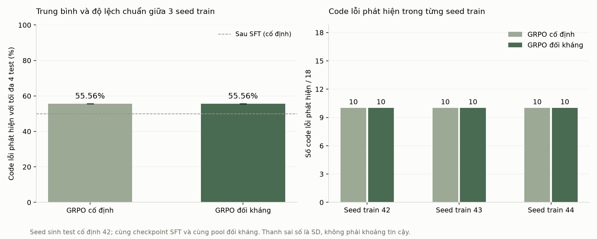

# Sinh test Python bằng học tăng cường đối kháng

Đồ án TTNT cá nhân, tham khảo cách tiếp cận của ATGen. Hệ thống dùng Qwen3.5-2B chạy trên máy để sinh test tìm lỗi trong các hàm Python nhỏ. Protagonist học bằng LoRA + GRPO; adversary giữ nguyên trọng số và sinh chương trình lỗi để bổ sung dữ liệu học.

## Chạy giao diện

Trên bản cài đặt hiện tại, nhấp `MO_GIAO_DIEN.cmd`, mở http://127.0.0.1:7860/?__theme=light. Nhấp `DONG_GIAO_DIEN.cmd` để đóng dịch vụ. Mở giao diện không tự huấn luyện.

- **Demo:** xem đề bài, code, input/expected và kết quả của ba phiên bản model. Chọn Bản ghi đã lưu để xem ngay hoặc Chạy trên máy để sinh kết quả mới trên GPU.
- **Kết quả:** bảng đầy đủ trên Validation. Bảng thay seed sinh test và bảng thay seed huấn luyện được trình bày riêng.
- **Thực nghiệm:** chạy tác vụ, theo dõi log và dừng. Chỉ cho phép một tác vụ GPU từ giao diện tại một thời điểm.
- **Huấn luyện / TensorBoard:** xem loss SFT, reward GRPO và gradient.

Ví dụ thực tế trong Demo: đề yêu cầu đảo ngược danh sách, code lỗi lại trả nguyên danh sách. Model sinh `{"input":{"values":[3,1,1]},"expected":[1,1,3]}`; bộ chấm xác nhận expected đúng, trong khi code trả `[3,1,1]`, nên test bắt được lỗi.

## Quy trình thực nghiệm

1. Kiểm tra local inference, cập nhật LoRA, lưu/nạp adapter và một pilot GRPO.
2. Xây bộ bài Python nội bộ và bộ chấm. Input phải thuộc miền, expected được đối chiếu với reference; reference không xuất hiện trong prompt.
3. Có baseline ban đầu, lượt GRPO sơ bộ 72 bước và SFT 72 bước. Vì vậy mốc Sau SFT có lineage `base → GRPO sơ bộ → SFT`.
4. Adversary local sinh 256 ứng viên cho 16 bài Train. Bộ lọc giữ code sai trên miền hữu hạn nhưng vượt qua ít nhất một bộ test hợp lệ của policy hiện tại; loại code không được hỗ trợ và trùng hành vi trong pool.
5. Hai nhánh bắt đầu từ cùng adapter SFT, optimizer mới và cùng thứ tự 96 lượt học. Nhánh cố định dùng code curated; nhánh đối kháng thay 20 lượt bằng 11/12 code đã lọc. Mỗi lượt sinh 4 test và cập nhật theo reward.
6. Chấm adapter cuối trên cùng 18 code Validation, mỗi code tối đa 4 test. Giữ cả đầu ra sai hoặc bị cắt; không tự sửa output rồi tính điểm.
7. Kiểm tra thêm seed sinh test và seed huấn luyện theo kế hoạch đã lưu. Test được giữ lại cho bước đánh giá cuối, chưa dùng để tinh chỉnh.

Reward hiện tại: 0 nếu sai định dạng/ngoài miền/chưa sinh xong; 0,1 nếu input hợp lệ nhưng expected sai; 0,3 nếu expected đúng nhưng chưa bắt lỗi; 1 nếu expected đúng và phát hiện lỗi. Code do adversary sinh được chạy bằng trình thông dịch Python giới hạn, không dùng `exec`/`eval` cho code đó. Lỗi giới hạn thông dịch không được tính là bắt bug.

## Kết quả bước đầu

Thử nghiệm trên 18 code lỗi thuộc 6 bài Validation, mỗi code sinh 4 test. Bảng dưới dùng seed sinh test 42; kết quả GRPO là trung bình ba seed huấn luyện 42, 43, 44 từ cùng checkpoint SFT và cùng pool đối kháng.

| Chỉ số | Sau SFT | GRPO cố định | GRPO đối kháng |
|---|---:|---:|---:|
| Input/JSON hợp lệ | 77,78% | 81,94% | 81,02% |
| Expected đúng | 43,06% | 48,61% | 49,54% |
| Test bắt lỗi | 27,78% | 31,02% | 30,09% |
| Code lỗi được phát hiện @4 | 50,00% | 55,56% | 55,56% |

Hai nhánh GRPO đều bắt 10/18 code ở cả ba seed train. Dữ liệu đối kháng chưa tạo lợi thế về số code được phát hiện trong phép thử này. Test chưa được đánh giá.



Số liệu chi tiết nằm trong `results/grpo-seed-check/`: bảng theo seed, bảng theo bài, phân loại lỗi và `metrics.json`.

Ba tỷ lệ hợp lệ / expected đúng / test bắt lỗi đều dùng mẫu số là toàn bộ test sinh. Tỷ lệ code phát hiện @4 dùng số code lỗi được ít nhất một trong bốn test bắt được. Khi lặp trên nhiều seed, vẫn là cùng 18 code Validation, không cộng thành nhiều code độc lập.

## Đường dẫn và môi trường

| Thành phần | Bản cài đặt hiện tại |
|---|---|
| Mã nguồn | `D:\DA\DoAn_TTNT_De19\adversarial-rl-testgen` |
| Model, dữ liệu và log | `D:\DA\TTNT_De19_Assets` |
| Python huấn luyện | `D:\DA\TTNT_De19_Assets\env\Scripts\python.exe` |
| Python giao diện | `D:\DA\TTNT_De19_Assets\tools\gui\env\Scripts\python.exe` |
| Model gốc | `D:\DA\TTNT_De19_Assets\models\Qwen3.5-2B` |

Các script thí nghiệm hiện dùng đường dẫn D: và kiểm tra hash của dữ liệu, code, pool, adapter nguồn. Model, checkpoint, cache, log đầy đủ và các file trạng thái `LATEST_*.json`/`DEMO_CATALOG.json` được lưu ngoài Git. Giao diện hiện cần các tài nguyên này trên máy; bản clone chưa tự tải và khôi phục toàn bộ thí nghiệm. Phần đóng gói để chạy trên máy mới đang được hoàn thiện.

`requirements.txt` ghi phiên bản môi trường huấn luyện đã dùng; `requirements-ui.txt` dành cho môi trường giao diện. PyTorch trong bản cài đặt này dùng CUDA 13.2.

Máy đã kiểm tra: RTX 4060 Laptop 8 GB, suy luận/huấn luyện BF16. Bộ nạp mmap giảm áp lực bộ nhớ khi đọc checkpoint trên Windows. Một số kernel tối ưu chưa cài nên có thông báo dùng triển khai PyTorch tham chiếu; kết quả chạy và số liệu thời gian được giữ trong log.

Lệnh chạy thêm thí nghiệm seed GRPO, chỉ chạy khi không có tác vụ GPU khác:

```powershell
& 'D:\DA\TTNT_De19_Assets\env\Scripts\python.exe' -B 'D:\DA\DoAn_TTNT_De19\adversarial-rl-testgen\scripts\run_grpo_replicates.py'
```

Mỗi lần chạy tạo thư mục evidence mới, không ghi đè kết quả cũ. Trước khi train, chương trình kiểm tra cấu hình và đối chiếu 72 đầu ra của một adapter cũ với bộ nạp mới. Kế hoạch giữ 96 bước/nhánh, checkpoint cuối, hai seed mới 43/44; không đổi kế hoạch theo điểm giữa chừng.

## Giới hạn hiện tại

Đây là thực nghiệm trên bài Python nhỏ tự xây dựng, chưa tái hiện benchmark APPS/Codeforces ở quy mô bài báo. Đã có một lần làm mới curriculum đối kháng; adversary chưa học cập nhật trọng số. Các khác biệt điểm số nhỏ cần được phân tích cùng độ dao động và các ví dụ thất bại.
