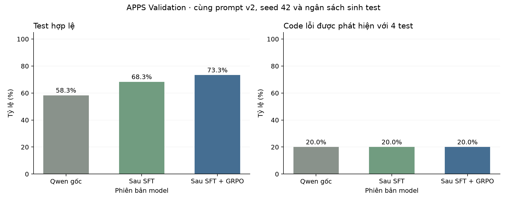

# Adversarial Reinforcement Learning for Test Case Generation

Đồ án TTNT cá nhân: huấn luyện tăng cường đối kháng để sinh ca kiểm thử. Hệ thống dùng Qwen3.5-2B chạy local để sinh input và expected cho hàm Python. Gradio điều khiển thí nghiệm; Transformers, PEFT và TRL đảm nhiệm suy luận và huấn luyện trên GPU.

Nhánh `apps-introductory` đang dùng dữ liệu APPS. Đã chạy SFT, GRPO cố định và hai vòng curriculum đối kháng bằng model local; các kết quả dữ liệu nội bộ cũ không được gộp vào bảng APPS.

## Tiến độ và phân tích bổ sung

[Roadmap APPS hiện tại](docs/APPS_PROGRESS.md) · [Phân tích lỗi](results/apps-error-analysis) · [Các phép thử tinh chỉnh](results/apps-tuning) · [EDA và pipeline](results/apps-data-profile)

Hai nhánh GRPO cuối phát hiện cùng hai code; nhánh đối kháng mất tám cơ hội vì expected sai. Đã thử thinking và hai cách diễn đạt hợp đồng đầu ra trên Train; các ứng viên chưa qua tiêu chí nên giữ prompt v2 và checkpoint hiện tại. Đây là các phép thử suy luận, không phải lượt RL mới. Test vẫn được giữ lại.

## Dữ liệu

Nguồn: [codeparrot/apps](https://huggingface.co/datasets/codeparrot/apps), revision `21e74ddf8de1a21436da12e3e653065c5213e9d1`, được [kho APPS của tác giả](https://github.com/hendrycks/apps) dẫn tới.

Chọn 29 bài Introductory dạng gọi hàm trong APPS Train, giữ nguyên đề và ID nguồn. Miền input được giới hạn để hai lời giải nguồn có thể được đối chiếu trên toàn bộ miền. Code lỗi được tạo bằng thay đổi AST từ lời giải nguồn, không phải code lỗi có sẵn trong APPS.

| Tập phát triển | Bài nguồn | Code lỗi |
|---|---:|---:|
| Train | 17 | 41 |
| Validation | 5 | 15 |
| Test giữ lại | 7 | 18 |

Các tập tách theo bài và URL. Đã kiểm tra 26.833 cặp code/input. Test phát triển nằm trong APPS Train, không phải Test chính thức. Model chưa được đánh giá trên hai tập Test này. Đây là tập con nhỏ có code đột biến, không phải kết quả benchmark toàn bộ APPS Introductory.

Xem [nguồn và bộ lọc dữ liệu](docs/APPS_DATASET.md), [quy trình huấn luyện](docs/APPS_TRAINING.md).

## Kết quả đối kháng hiện tại

Hai nhánh bắt đầu từ cùng adapter SFT, mỗi nhánh hai vòng × 48 bước GRPO. Cùng prompt v2, Validation, seed 42 và bốn test/code. Đối chứng cũng khởi tạo lại optimizer mỗi vòng; chi phí sinh/lọc code là phần tính toán thêm của nhánh đối kháng.

| Phiên bản | Test hợp lệ /60 | Expected đúng /60 | Test bắt lỗi /60 | Code phát hiện @4 /15 |
|---|---:|---:|---:|---:|
| Qwen gốc | 35 | **15** | **4** | **3** |
| SFT | 41 | 13 | **4** | **3** |
| SFT + GRPO cố định | **42** | 13 | 3 | 2 |
| SFT + GRPO đối kháng | 41 | 12 | 3 | 2 |

Chữ đậm là giá trị lớn nhất từng cột, kể cả khi hòa. Tất cả mẫu sai/bị cắt vẫn nằm trong mẫu số.

Nhánh đối kháng bắt được lỗi ở 2/15 code; nhánh cố định là 2/15. Đây là một seed trên năm bài Validation; chưa đủ kết luận hiệu quả tổng quát hoặc tái lập mức cải thiện trong bài báo.

Code bổ sung được Qwen local gốc sinh rồi lọc: còn sai trong miền kiểm tra nhưng vượt qua test đúng của policy hiện tại. Chỉ adapter sinh test được học bằng RL; model sinh code giữ nguyên trọng số. Làm mới curriculum giữa các vòng là cách triển khai theo lô ở quy mô nhỏ.

[Kết quả và phân tích từng vòng](results/apps-adversarial) · [Đối chiếu với ATGen](docs/ATGEN_ALIGNMENT.md)


## Lượt GRPO cố định trước đó

Cả ba mốc dùng prompt `apps-call-v2`, cùng 15 code Validation, bốn test/code, seed 42 và tối đa 96 token/completion. SFT bắt đầu từ Qwen gốc và LoRA mới; GRPO bắt đầu từ đúng adapter SFT đã chấm, optimizer mới.

| Chỉ số | Qwen gốc | Sau SFT | Sau SFT + GRPO |
|---|---:|---:|---:|
| Test hợp lệ | 35/60 (58.33%) | **41/60 (68.33%)** | **44/60 (73.33%)** |
| Expected đúng | 15/60 (25.00%) | 13/60 (21.67%) | **15/60 (25.00%)** |
| Test bắt lỗi | 4/60 (6.67%) | 4/60 (6.67%) | 4/60 (6.67%) |
| Code lỗi phát hiện @4 | 3/15 (20.00%) | 3/15 (20.00%) | 3/15 (20.00%) |

Chữ đậm đánh dấu số tăng so với mốc liền trước, không biểu thị ý nghĩa thống kê. Tỷ lệ hợp lệ tăng sau học; expected đúng ở mốc GRPO trở lại bằng Qwen gốc. Số code phát hiện được vẫn là 3/15, nên chưa có bằng chứng tăng khả năng tìm lỗi trên phép thử này.



SFT dùng pool 319 mẫu input/expected từ Train, ngân sách 64 bước và bốn mẫu/bước (256 lượt ví dụ). Đây là học có giám sát, không phải RL. GRPO chạy 96 bước, sinh 384 test trong lúc học. Có 78 bước GRPO với gradient khác 0; 24 tensor adapter thay đổi và bản lưu khớp tham số sau học. Đỉnh bộ nhớ PyTorch cấp phát trong GRPO khoảng 4.791 GiB.

Đã chấm lại target SFT, 384 mẫu GRPO và toàn bộ 60 đầu ra của mỗi mốc Validation. Dữ liệu, prompt theo từng case, seed và cấu hình sinh của ba mốc khớp nhau. Log thô, gradient, adapter và mã nguồn lúc chạy được lưu trên D:; bản tóm tắt nằm ở [results/apps-sft-grpo](results/apps-sft-grpo).

Chỉ đổi prompt từ v1 sang v2 đã giúp Qwen gốc tăng test hợp lệ từ 14/60 lên 35/60 và code phát hiện từ 2/15 lên 3/15. Mức tăng đó được ghi riêng, không tính là lợi ích của huấn luyện. Kết quả pilot v1 vẫn giữ trong `results/apps-pilot` và các thư mục evidence cũ.

Reward: 0 nếu sai JSON/ngoài miền/bị cắt; 0,1 nếu input hợp lệ nhưng expected sai; 0,3 nếu expected đúng nhưng chưa bắt lỗi; 1 nếu expected đúng và bắt lỗi. Các mẫu sai vẫn nằm trong mẫu số. Lỗi giới hạn bộ chấm không được tính là bắt bug.

## Chạy giao diện

Trên bản cài đặt hiện tại, nhấp `MO_GIAO_DIEN.cmd`, mở http://127.0.0.1:7860/?__theme=light. Nhấp `DONG_GIAO_DIEN.cmd` để đóng dịch vụ. Mở trang không tự train.

- **Demo:** xem đề, code và đầu ra của Qwen gốc, GRPO cố định và GRPO đối kháng; có thể sinh bốn test mới cho một code trên GPU.
- **Kết quả:** bảng toàn bộ Validation; không chỉ giữ các bài thành công.
- **Dữ liệu:** nguồn, cách chia tập và giới hạn thí nghiệm.
- **Thực nghiệm:** kiểm tra dữ liệu, chấm model và khởi chạy huấn luyện; có nút dừng và log.
- **Huấn luyện:** reward, gradient và thông số lượt GRPO mới nhất. TensorBoard tại http://127.0.0.1:6006 chỉ đọc các lượt APPS.

Tác vụ **Huấn luyện SFT + GRPO trên APPS** chạy lại toàn bộ từ Qwen gốc: baseline, SFT 64 bước, GRPO theo số bước chọn và chấm từng mốc. Tác vụ **Huấn luyện GRPO trên Train** bắt đầu từ adapter SFT đã lưu, không học nối tiếp adapter GRPO cuối. Mỗi lần có optimizer và thư mục evidence mới.

Nút Sinh 4 test trong Demo chỉ suy luận/chấm, không cập nhật tham số. Trong log có nút Đầu log/Cuối log; tắt Tự cập nhật log để đọc. Dừng tác vụ sẽ mất cập nhật chưa lưu của lượt đó; kết quả đã lưu vẫn được giữ.

## Chạy bằng PowerShell

Các lệnh dùng môi trường đã cài trên máy này, khi GPU không có tác vụ khác:

```powershell
$env:PYTHONUTF8 = '1'
$python = 'D:/DA/TTNT_De19_Assets/env/Scripts/python.exe'
$project = 'D:/DA/DoAn_TTNT_De19/adversarial-rl-testgen'
& $python -B "$project/scripts/verify_apps.py"
& $python -B "$project/scripts/apps_round.py" --grpo-steps 96
```

`fetch_apps.py` tải/kiểm tra nguồn đã ghim phiên bản; `prepare_apps.py` chỉ chuẩn bị dữ liệu khi thư mục phiên bản chưa tồn tại, chủ động từ chối ghi đè dữ liệu đã đóng băng. Không cần tải hoặc chuẩn bị lại trên máy hiện tại.

## Môi trường và giới hạn

| Thành phần | Bản cài đặt hiện tại |
|---|---|
| Mã nguồn | `D:/DA/DoAn_TTNT_De19/adversarial-rl-testgen` |
| Model, dữ liệu, evidence | `D:/DA/TTNT_De19_Assets` |
| Python huấn luyện | `D:/DA/TTNT_De19_Assets/env/Scripts/python.exe` |
| Python giao diện | `D:/DA/TTNT_De19_Assets/tools/gui/env/Scripts/python.exe` |
| GPU | RTX 4060 Laptop 8 GB |
| Model | Qwen3.5-2B, BF16, mmap loader trên Windows |

Phiên bản thư viện của lượt đánh giá/GRPO nằm trong result. Môi trường train và giao diện có requirements riêng. Model, môi trường Python, cache, log lớn và adapter không đưa vào Git. Clone repo chưa tự tải model hay tái lập toàn bộ môi trường; script còn phụ thuộc đường dẫn D:.

Năm bài Validation và một seed chưa đủ kết luận ổn định. Miền hữu hạn, test tham chiếu và hai lời giải nguồn giúp kiểm tra dữ liệu, không chứng minh khả năng tổng quát trên APPS. Chưa xác nhận model nền có từng gặp bài công khai này khi tiền huấn luyện hay không. Bản sao lưu trước chuyển đổi ở `D:/DA/TTNT_Backups/De19-before-APPS-20261028-112210`.
