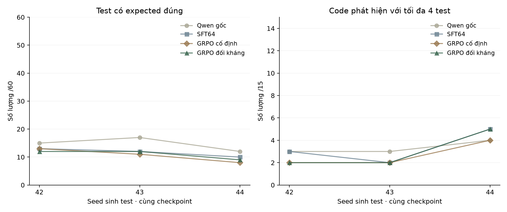

# Kiểm tra lấy mẫu của hai nhánh đối kháng và cố định

Cùng checkpoint SFT64, hai nhánh GRPO cuối sau 2 vòng × 48 bước, so với Qwen gốc. Ba seed sinh test 42/43/44, mỗi lượt 15 code Validation × 4 test. Kế hoạch bổ sung được ghi sau khi đã biết kết quả seed 42, trước sáu lượt suy luận mới. Sáu kết quả cũ được tái sử dụng có kiểm tra hash.

**Đây là một seed huấn luyện và ba seed sinh test.** Không phải ba lần train độc lập. Không đổi checkpoint, prompt, tập dữ liệu hoặc trọng số; Test vẫn chưa dùng.

| Phiên bản | Seed sinh | Hợp lệ /60 | Expected đúng /60 | Test bắt lỗi /60 | Code phát hiện /15 |
|---|---:|---:|---:|---:|---:|
| Qwen gốc | 42 | 35 | 15 | 4 | 3 |
| SFT64 | 42 | 41 | 13 | 4 | 3 |
| GRPO cố định | 42 | 42 | 13 | 3 | 2 |
| GRPO đối kháng | 42 | 41 | 12 | 3 | 2 |
| Qwen gốc | 43 | 35 | 17 | 3 | 3 |
| SFT64 | 43 | 42 | 12 | 2 | 2 |
| GRPO cố định | 43 | 40 | 11 | 2 | 2 |
| GRPO đối kháng | 43 | 40 | 12 | 2 | 2 |
| Qwen gốc | 44 | 36 | 12 | 4 | 4 |
| SFT64 | 44 | 46 | 10 | 5 | 5 |
| GRPO cố định | 44 | 46 | 8 | 4 | 4 |
| GRPO đối kháng | 44 | 46 | 9 | 5 | 5 |

## Trung bình ± độ lệch chuẩn mẫu

| Phiên bản | Hợp lệ /60 | Expected đúng /60 | Test bắt lỗi /60 | Code phát hiện /15 |
|---|---:|---:|---:|---:|
| Qwen gốc | 35.33 ± 0.58 | **14.67 ± 2.52** | **3.67 ± 0.58** | **3.33 ± 0.58** |
| SFT64 | **43.00 ± 2.65** | 11.67 ± 1.53 | **3.67 ± 1.53** | **3.33 ± 1.53** |
| GRPO cố định | 42.67 ± 3.06 | 10.67 ± 2.52 | 3.00 ± 1.00 | 2.67 ± 1.15 |
| GRPO đối kháng | 42.33 ± 3.21 | 11.00 ± 1.73 | 3.33 ± 1.53 | 3.00 ± 1.73 |

Chữ đậm đánh dấu trung bình cao nhất, kể cả khi hòa. SD mô tả biến động lấy mẫu, không phải khoảng tin cậy; các mutant cùng bài có tương quan. Không dùng bảng này để tuyên bố ý nghĩa thống kê.

## Đối kháng trừ cố định theo cùng seed

| Seed sinh | Hợp lệ | Expected đúng | Test bắt lỗi | Code phát hiện |
|---:|---:|---:|---:|---:|
| 42 | -1 | -1 | +0 | +0 |
| 43 | +0 | +1 | +0 | +0 |
| 44 | +0 | +1 | +1 | +1 |

Hình 1. Kết quả của bốn checkpoint cố định. Mỗi điểm là một lần sinh 60 test; trục dọc ghi số lượng và mẫu số. Các đường trùng nhau vẫn được giữ nguyên.

## Chi phí thực hiện đã ghi được

| Nhánh | GRPO (giây) | Probe + sinh/lọc code (giây) | Chấm Validation hai vòng (giây) | Đỉnh PyTorch cấp phát (GiB) |
|---|---:|---:|---:|---:|
| GRPO cố định | 522.5 | 0.0 | 44.6 | 4.836 |
| GRPO đối kháng | 534.6 | 655.1 | 41.2 | 4.978 |

SFT64 dùng chung: 186.1 giây, không cộng hai lần vào chênh lệch hai nhánh. Nhánh đối kháng còn phải probe Train và sinh/lọc code; vì vậy cùng 96 bước GRPO không có nghĩa là cùng tổng chi phí.

Đây là tổng các pha có thời gian được ghi, chưa phải tổng thời gian từ bấm chạy đến hoàn tất. Nạp model, audit, tạo curriculum, điều phối và khoảng chờ chưa được bao quát đầy đủ. Đỉnh PyTorch cấp phát không phải tổng VRAM máy/GPU; không cộng các đỉnh giữa các pha. Không lấy thời gian export TensorBoard làm thời gian train.

Raw output, adapter và kế hoạch nằm trong thư mục evidence được ghi ở metrics.json. Chạy lại bảng/hình từ evidence: `python scripts/apps_adversarial_review.py --summarize <folder>`. Không cần nạp model để dựng lại.

## Đọc kết quả hiện tại

Đã kiểm tra Qwen gốc, SFT64 và hai checkpoint GRPO cuối với seed sinh test 42/43/44; mỗi lượt 60 test trên 15 code Validation. Sáu lượt mới và sáu kết quả cũ được chấm lại/đối chiếu; cùng prompt, cách lấy mẫu và bộ chấm. Đây là **một seed huấn luyện, ba seed sinh test**, không phải ba lượt train độc lập.

Code phát hiện trung bình ± SD: Qwen gốc 3.33 ± 0.58/15; SFT64 3.33 ± 1.53/15; cố định 2.67 ± 1.15/15; đối kháng 3.00 ± 1.73/15. Không có bằng chứng từ phép kiểm tra nhỏ này để tuyên bố đối kháng tốt hơn; SD chỉ mô tả biến động lấy mẫu.

SFT64 không tạo lợi thế rõ về phát hiện lỗi so với Qwen gốc; hai nhánh GRPO cũng chưa vượt được các baseline trên kiểm tra nhỏ này. Tăng tỷ lệ JSON/input hợp lệ không tự đồng nghĩa tăng test bắt lỗi.

Trong phần chi phí, trường training_seconds của SFT gồm vòng học cùng probe sau học và lưu adapter; train_runtime của GRPO do Trainer ghi. Đây là các pha đo khác nhau, không nên suy ra tốc độ thuật toán từ việc chia trực tiếp hai con số SFT/GRPO. Đánh giá và sinh/lọc code ghi thời gian sau khi nạp model. Nên dùng bảng để mô tả ngân sách và phần tính toán bổ sung, không gọi đây là benchmark thời gian toàn quy trình.
