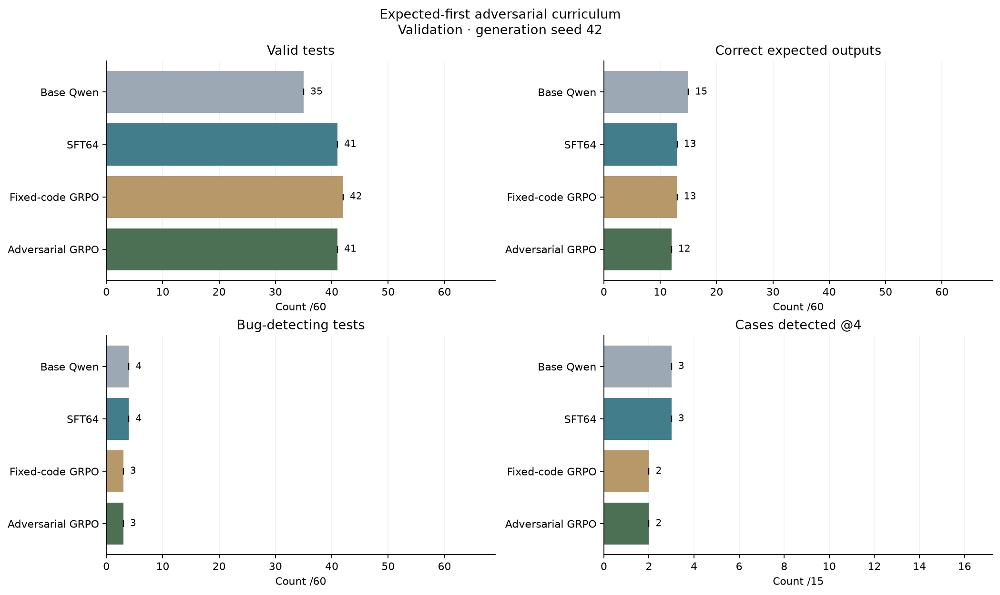

# Expected-first adversarial curriculum

Both branches start from the same SFT64 adapter and run two rounds of 48 GRPO steps. Results below use generation seed 42.

## Per-run counts

| Configuration | Valid /60 | Correct expected /60 | Bug-detecting tests /60 | Functions detected /15 |
|---|---|---|---|---|
| Base Qwen | 35 | 15 | 4 | 3 |
| SFT64 | 41 | 13 | 4 | 3 |
| Fixed-code GRPO | 42 | 13 | 3 | 2 |
| Adversarial GRPO | 41 | 12 | 3 | 2 |

The fixed-code and adversarial branches each detected 2/15 functions.

Figure 1. Expected-first adversarial curriculum.

## Data files

[environment.json](environment.json) · [metrics.csv](metrics.csv) · [metrics.json](metrics.json) · [per-problem.csv](per-problem.csv)

[Evaluation guide](../../docs/EXPERIMENTS.md).
