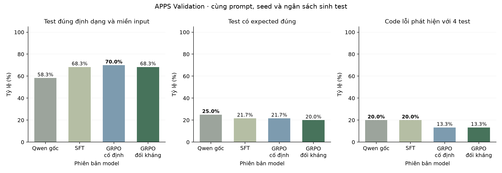

# Curriculum đối kháng với nhãn expected-first

Hai nhánh dùng cùng SFT64 cha, cùng hai vòng × 48 bước GRPO. Bảng dùng seed sinh 42.

## Kết quả từng lượt

| Cấu hình | Hợp lệ /60 | Expected đúng /60 | Test bắt lỗi /60 | Code phát hiện /15 |
|---|---|---|---|---|
| Qwen gốc | 35 | 15 | 4 | 3 |
| SFT64 | 41 | 13 | 4 | 3 |
| GRPO cố định | 42 | 13 | 3 | 2 |
| GRPO đối kháng | 41 | 12 | 3 | 2 |

Cố định và đối kháng đều phát hiện 2/15 code ở mốc cuối.

Hình 1. Curriculum đối kháng với nhãn expected-first.

## Dữ liệu

[environment.json](environment.json) · [metrics.csv](metrics.csv) · [metrics.json](metrics.json) · [per-problem.csv](per-problem.csv)

[Cấu hình và chỉ số đánh giá](../../docs/EXPERIMENTS.md).
