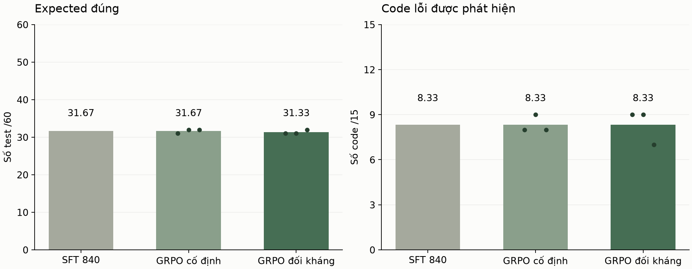

# Lấy mẫu cân bằng cho GRPO đối kháng

Hai nhánh cùng bắt đầu từ SFT 840 trên tập Train 58 bài/145 code. Mỗi nhánh học hai vòng 64 bước, learning rate 5e-6, reward chia đều. Seed train đã chạy: 42. Mỗi checkpoint cuối được chấm trên ba seed sinh 42, 43, 44.

Một nửa nhóm học lấy từ các vị trí có code đối kháng, một nửa từ phần Train còn lại. Nhánh cố định dùng cùng lịch case ID nhưng giữ code AST ban đầu. Code đối kháng được làm mới sau vòng đầu; model sinh code giữ nguyên trọng số.

## Validation

| Phiên bản | Expected đúng /60 | Test bắt lỗi /60 | Code phát hiện /15 |
|---|---:|---:|---:|
| SFT 840 | 31.67 | 14.33 | 8.33 |
| GRPO cố định | 31.67 | **14.67** | 8.33 |
| GRPO đối kháng | 31.33 | 14.00 | 8.33 |

SFT là một checkpoint cố định với ba seed sinh. Mỗi nhánh GRPO có 1 lượt train và 3 lượt đánh giá. Seed sinh không phải seed huấn luyện. Phần in đậm cao hơn SFT, không biểu thị kiểm định ý nghĩa thống kê.

Hình 1. Số test có expected đúng và số code phát hiện trên Validation. Chấm nhỏ là từng lượt đánh giá GRPO, cột là trung bình.

## Lượng học trên code đối kháng

| Seed train | Vòng | Vị trí đối kháng | Nhóm học | Test sinh | Nhóm có cập nhật |
|---|---:|---:|---:|---:|---:|
| 42 | 1 | 17 | 32 | 128 | 22 |
| 42 | 2 | 25 | 32 | 128 | 25 |

Nhánh đối kháng có 64 nhóm thực sự học trên code mới, tương ứng 256 test; 47 nhóm vừa có chênh lệch reward vừa có gradient khác 0.

## Nhận xét

So với nhánh cố định cùng điều kiện, đối kháng thay đổi +0.00 code phát hiện/15 và -0.33 expected đúng/60. Điều kiện chọn ứng viên từ Validation chưa đạt; giữ SFT làm bản sử dụng.

Vòng hai kiểm tra policy trên code thực sự đang học. Code chưa bị bắt được giữ lại; chỉ vị trí đã được policy giải quyết mới tìm code thay thế. Một lượt trước đó đã dừng ở bước lấy mẫu khi phát hiện nó còn kiểm tra trên AST gốc; checkpoint vòng một được giữ và chấm lại vì phần huấn luyện không đổi.

Seed 43 chỉ chạy xác nhận nếu pilot seed 42 đạt điều kiện cải thiện đã ghi trong protocol. Pilot chưa có lợi thế đạt điều kiện nên dừng ở một seed train.

Lượt học này diễn ra sau sự kiện Test của phiên bản trước. Test cũ không chạy lại và không được dùng để báo kết quả checkpoint mới. Các số ở đây chỉ là Validation đã được dùng nhiều lần trong quá trình phát triển.

Lấy mẫu, learning rate và ngân sách khác đợt trước, nên không quy toàn bộ chênh lệch với đợt trước cho riêng lịch cân bằng. Đối chứng trong đợt này chỉ khác code tại vị trí đối kháng.

Mỗi vòng lưu curriculum, lịch học, rollout, gradient, hash adapter và mã nguồn. `runs.csv`, `exposure.csv` và `per-problem.csv` giữ các số đếm để kiểm tra bảng tổng hợp.

## Expected và khả năng chọn input

| Nhánh | Input có thể bắt lỗi /60 | Cơ hội mất do expected sai /60 |
|---|---:|---:|
| Cố định | 28.67 | 14.00 |
| Đối kháng | 27.67 | 13.67 |

Bảng này chỉ phân tích input: expected được thay bằng output của reference để đo cơ hội bắt lỗi đã mất. Đây không phải kết quả sinh test hoàn chỉnh của model và không thay số liệu Attack rate ở bảng chính.

## Kiểm tra lại code đã học

Phép chẩn đoán riêng dùng 15 code đối kháng khác nhau từ curriculum vòng một, với seed sinh 43 và 44. Hai checkpoint GRPO ở bảng này mới học xong vòng một, 64 bước. Đây là code Train đã được dùng trong quá trình học, không phải Validation hoặc Test.

| Phiên bản | Expected đúng /60 | Test bắt lỗi /60 | Code phát hiện /15 |
|---|---:|---:|---:|
| SFT 840 | 43.00 | 10.00 | 6.50 |
| GRPO cố định sau vòng 1 | 45.50 | 11.50 | 7.00 |
| GRPO đối kháng sau vòng 1 | 44.50 | 11.50 | 7.00 |

Cả hai nhánh RL tăng nhẹ số code phát hiện trong phép đo này, nhưng nhánh đối kháng chưa có lợi thế riêng. Số liệu Train không thay kết quả Validation ở bảng chính.
