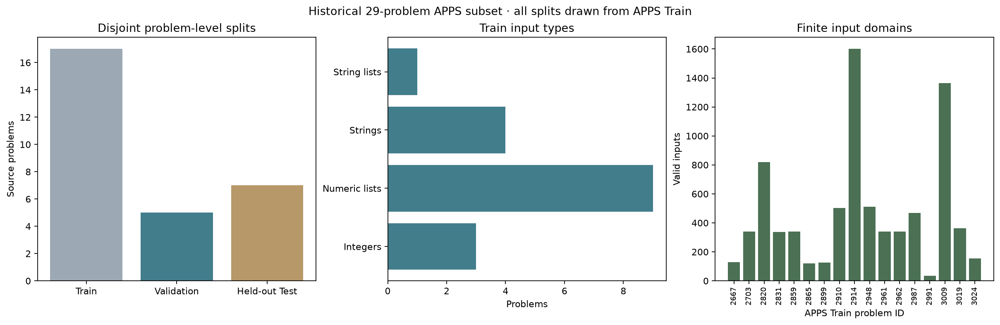
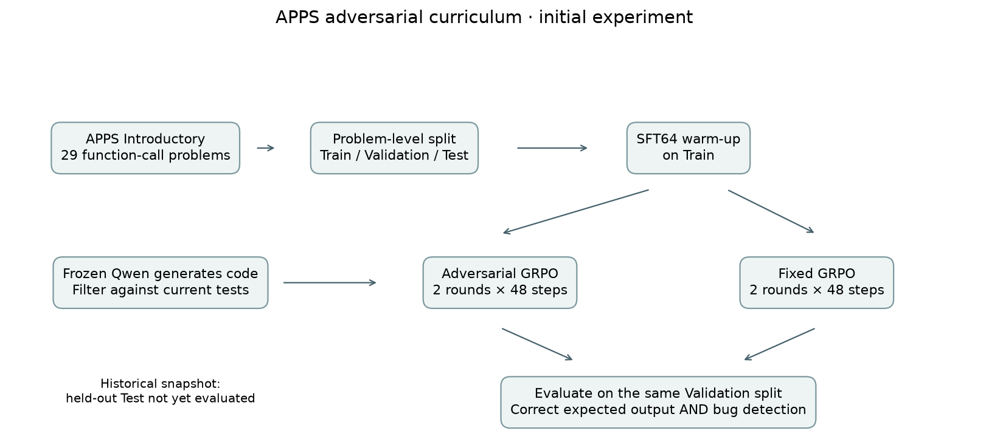

# Earlier APPS dataset profile

The earlier subset contains 29 problems and 74 mutants, split by source problem into Train, Validation and Test. Feature summaries use Train; split sizes come from the manifest.

See [dataset construction](../../docs/APPS_DATASET.md) for source and verifier details. This profile describes the earlier subset, not the expanded 58-problem Train set.

Figure 1. Earlier APPS dataset profile.

Figure 2. Earlier APPS dataset profile.

## Data files

[profile.json](profile.json)

[Evaluation guide](../../docs/EXPERIMENTS.md).
