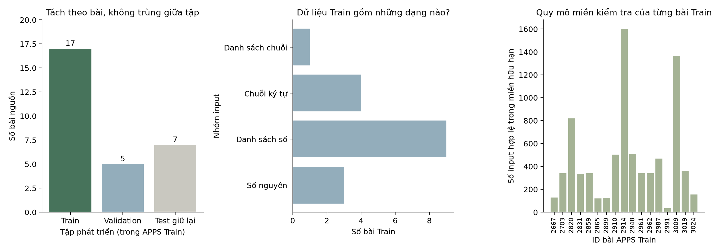

# Hồ sơ dữ liệu APPS

Thống kê từ manifest và nội dung Train. Số lượng Test lấy từ manifest đã đóng băng; không đọc nội dung Test, không chạy model trên Test. Đây là tập con 29 bài dạng gọi hàm, không đại diện toàn bộ APPS.

profile.json chứa số liệu gốc; chạy scripts/plot_apps_analysis.py để dựng lại.
