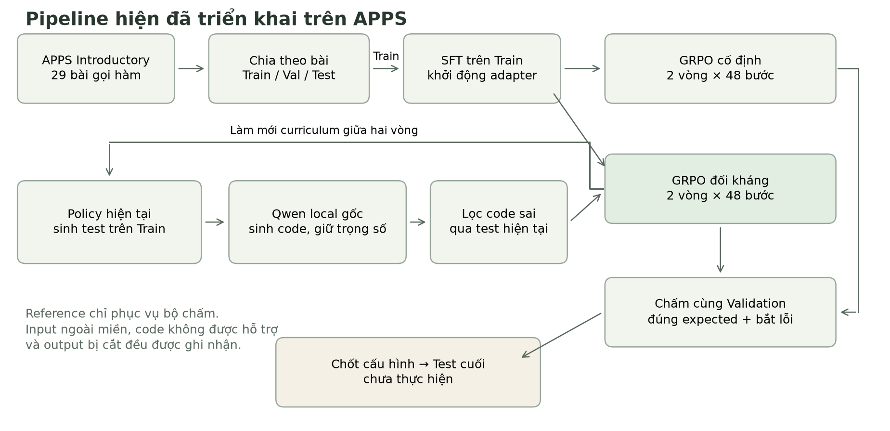

# Thống kê dữ liệu

Tập con APPS gồm 29 bài, 74 mutant, chia theo bài thành Train/Validation/Test. Phần thống kê đặc trưng dùng Train; số lượng tập chia lấy từ manifest.

Dữ liệu nguồn, hợp đồng input và bộ chấm được mô tả trong tài liệu dữ liệu.

Hình 1. Thống kê dữ liệu.

Hình 2. Thống kê dữ liệu.

## Dữ liệu

[profile.json](profile.json)

[Cấu hình và chỉ số đánh giá](../../docs/EXPERIMENTS.md).
