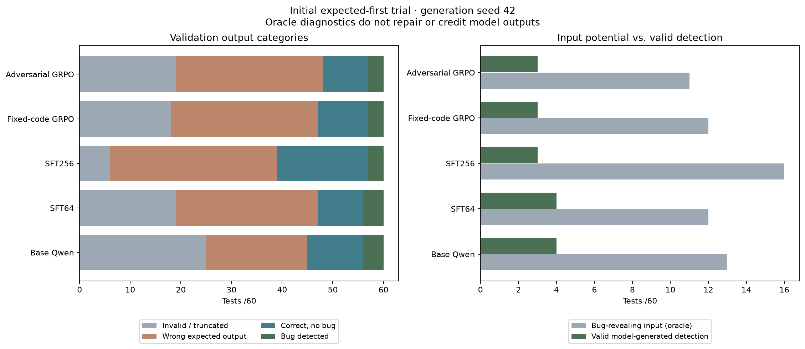

# Output errors in the initial adversarial trial

Validation outputs from expected-first checkpoints are classified by failure type and compared with inputs that could expose a bug.

Incorrect expected outputs prevent some otherwise useful inputs from counting as bug-detecting tests.

Figure 1. Output errors in the initial adversarial trial.

## Data files

[analysis.json](analysis.json) · [per-case.csv](per-case.csv) · [samples.csv](samples.csv)

[Evaluation guide](../../docs/EXPERIMENTS.md).
