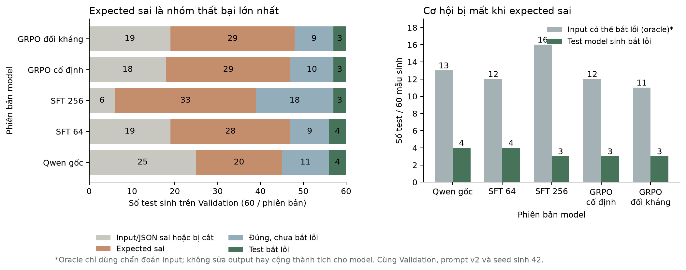

# Phân tích lỗi APPS

Chấm lại các bản ghi đã có, không gọi model hay cập nhật trọng số. Validation gồm 15 code / 60 mẫu sinh cho mỗi phiên bản. Test chưa được dùng.

| Phiên bản | Input/JSON sai hoặc bị cắt | Expected sai | Đúng nhưng chưa bắt lỗi | Test bắt lỗi | Input có khả năng bắt lỗi* | Cơ hội mất do expected sai* |
|---|---:|---:|---:|---:|---:|---:|
| base | 25 | 20 | 11 | 4 | 13 | 9 |
| sft | 19 | 28 | 9 | 4 | 12 | 8 |
| sft256 | 6 | 33 | 18 | 3 | 16 | 13 |
| control | 18 | 29 | 10 | 3 | 12 | 9 |
| adaptive | 19 | 29 | 9 | 3 | 11 | 8 |

*Hai cột cuối là chẩn đoán: giữ input mà model đã sinh và dùng reference để xem input đó có làm lộ lỗi không. Expected do reference cung cấp không được tính thành test đúng của model; các chỉ số chính không thay đổi. Đây là cách xem xét nút thắt input/expected, tương ứng ý tưởng Input Attack Rate ở ATGen §5.3.

Mốc sft là SFT64 lịch sử; mốc sft256 là kiểm chứng ngân sách riêng. Đối chứng 64/256 trong cùng quỹ đạo học nằm tại [apps-sft-budget](../apps-sft-budget/README.md). Không dùng hình tổng hợp này để gộp tác động SFT và RL.

## Hai nhánh có phát hiện cùng code không?

Cùng phát hiện: apps-train-2868/m3, apps-train-3014/m3. Chỉ cố định phát hiện: 0; chỉ đối kháng phát hiện: 0; cả hai bỏ sót: 13. Có 48/60 đầu ra giống hệt nhau.

Cùng số code phát hiện chưa có nghĩa là cùng tập code; bảng phân tích ở đây kiểm tra bằng ID. Đầu ra trùng nhau cũng không tự chứng minh adapter không học: tham số cập nhật và chất lượng đầu ra là hai kiểm chứng khác nhau.

## Giới hạn

Một seed và năm bài Validation chưa đủ kết luận tổng quát. Các ví dụ expected trùng đầu ra buggy chỉ là dấu hiệu quan sát, không chứng minh model đã sao chép cách tính của code lỗi. Không dùng Test để tìm nguyên nhân hay chọn cấu hình.
