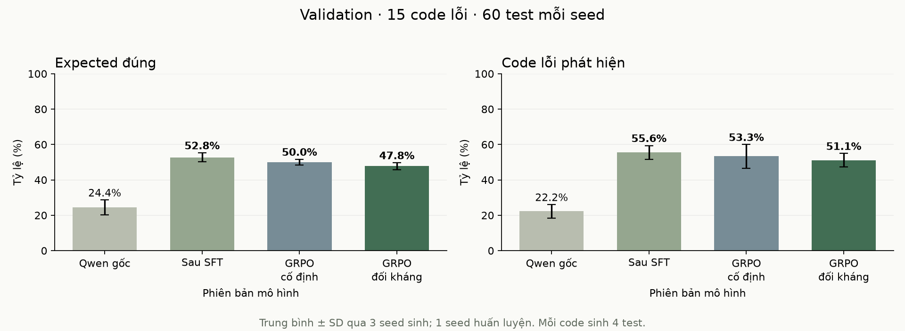
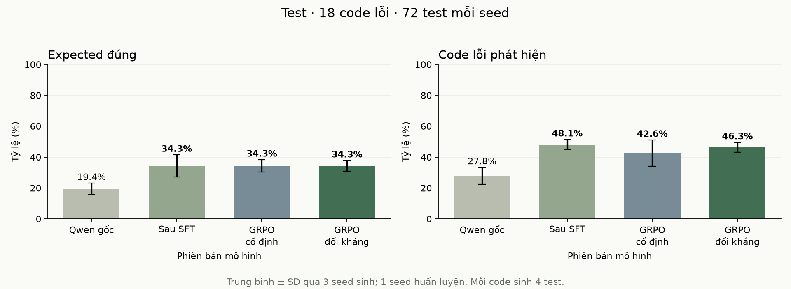

# Thực nghiệm trên tập APPS mở rộng

Hai nhánh GRPO cùng xuất phát từ SFT 840, dùng 145 vị trí code Train, reward chia đều và hai vòng × 32 bước. Nhánh đối kháng làm mới code giữa hai vòng; nhánh cố định giữ code ban đầu.

Model sinh code là Qwen3.5-2B gốc, không cập nhật trọng số. Bộ lọc nhận code còn sai trong miền thực nghiệm nhưng vượt qua test đúng do policy hiện tại sinh.

## Validation

| Phiên bản | Expected đúng /60 | Test bắt lỗi /60 | Code phát hiện /15 |
|---|---:|---:|---:|
| Qwen gốc | 14.67 | 3.67 | 3.33 |
| Sau SFT | **31.67** | **14.33** | **8.33** |
| GRPO cố định | **30.00** | **13.67** | **8.00** |
| GRPO đối kháng | **28.67** | **13.33** | **7.67** |

## Test cuối

| Phiên bản | Expected đúng /72 | Test bắt lỗi /72 | Code phát hiện /18 |
|---|---:|---:|---:|
| Qwen gốc | 14.00 | 7.00 | 5.00 |
| Sau SFT | **24.67** | **14.33** | **8.67** |
| GRPO cố định | **24.67** | **13.33** | **7.67** |
| GRPO đối kháng | **24.67** | **14.00** | **8.33** |

Trung bình ba seed sinh 42/43/44, một seed huấn luyện. Thanh sai số trong hình là SD. Phần in đậm cao hơn Qwen gốc cùng tập đánh giá; không biểu thị kiểm định ý nghĩa thống kê.

Hình 1. Kết quả Validation của bốn phiên bản, cùng ngân sách sinh bốn test/code.

Hình 2. Kết quả trên holdout Test sau khi chọn checkpoint bằng Validation.

Checkpoint chọn trước Test: **Sau SFT**. Test được chạy trong một sự kiện khóa protocol cho các phiên bản và seed đã định trước; không tinh chỉnh từ kết quả Test.

## Curriculum đối kháng

| Vòng | Code lấy mẫu | Được nhận | Vị trí đối kháng /145 | Test sinh trên code đối kháng |
|---|---:|---:|---:|---:|
| 1 | 416 | 20 | 17 | 4 |
| 2 | 392 | 11 | 13 | 8 |

## Phạm vi

Train 58 bài/145 code lỗi, Validation5/15 và Test7/18, tách theo bài và URL nguồn trong APPS Train. Không dùng APPS Test chính thức. Bốn phiên bản cùng prompt, model nền, bộ chấm và ngân sách sinh. SFT và RL cần được phân tích riêng.

Bộ chạy giới hạn 4.000 lệnh và 1 giây mỗi lần gọi hàm. Các đầu ra được lưu nguyên trạng và chấm lại để kiểm tra reward, chỉ số tổng hợp và hash checkpoint.

Mỗi cấu hình có một seed train; các mutant cùng bài có tương quan. Kết quả không đại diện cho toàn bộ APPS hoặc chương trình Python tùy ý.
