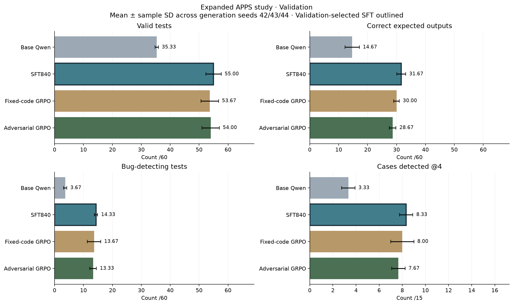
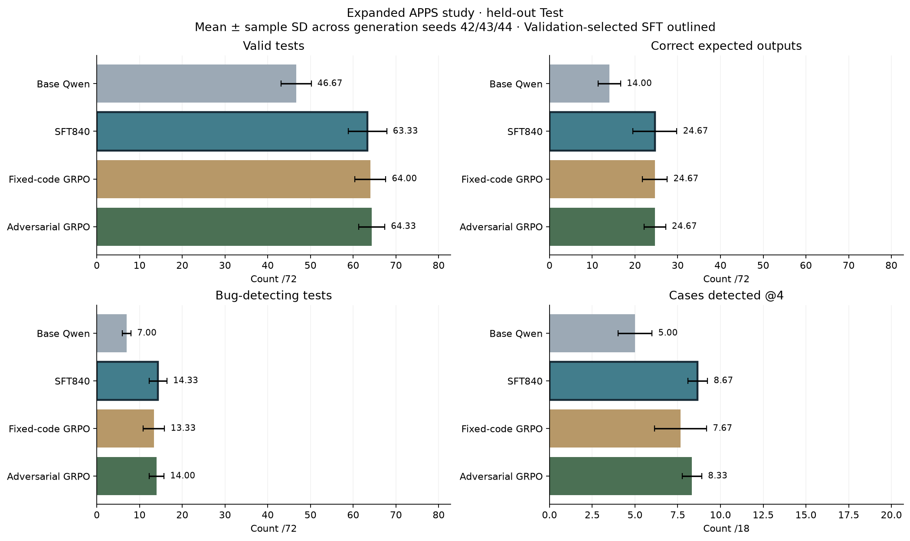

# Expanded APPS experiment

This study compares base Qwen, SFT840 and two GRPO branches. Both GRPO branches start from the same SFT adapter, use 145 Train positions and run two rounds of 32 steps with equal-weight rewards. The adversarial branch refreshes eligible faulty functions between rounds; the fixed-code branch retains the original functions.

The code generator is the frozen Qwen3.5-2B base model. Its candidates must still be faulty within the declared domain while passing the current policy's valid tests.

## Validation

| Checkpoint | Correct expected / 60 | Bug-detecting tests / 60 | Functions detected / 15 |
|---|---:|---:|---:|
| Base Qwen | 14.67 | 3.67 | 3.33 |
| SFT840 | 31.67 | 14.33 | 8.33 |
| Fixed-code GRPO | 30.00 | 13.67 | 8.00 |
| Adversarial GRPO | 28.67 | 13.33 | 7.67 |

## Held-out Test

| Checkpoint | Correct expected / 72 | Bug-detecting tests / 72 | Functions detected / 18 |
|---|---:|---:|---:|
| Base Qwen | 14.00 | 7.00 | 5.00 |
| SFT840 | 24.67 | 14.33 | 8.67 |
| Fixed-code GRPO | 24.67 | 13.33 | 7.67 |
| Adversarial GRPO | 24.67 | 14.00 | 8.33 |

Values are mean counts across generation seeds 42/43/44, with one training seed. Four tests are generated per faulty function. The plots show sample standard deviations, available numerically in [metrics.json](metrics.json).

SFT was selected from Validation before the locked Test event. It detected more faulty functions than the base model. Neither GRPO branch improved on SFT in this experiment.

## Adversarial curriculum

| Round | Sampled candidates | Accepted candidates | Adversarial positions / 145 | Tests generated on adversarial code |
|---|---:|---:|---:|---:|
| 1 | 416 | 20 | 17 | 4 |
| 2 | 392 | 11 | 13 | 8 |

## Scope and evidence

Dataset `apps-intro-expanded-v4-0b00cd05b256` contains 58 Train problems / 145 faulty functions, 5 Validation / 15 and 7 Test / 18. Splits are disjoint by source problem and URL within APPS Train. The official APPS Test split is unused.

The restricted interpreter allows up to 4,000 steps and one second per function call. Raw outputs were retained for rescoring and reward checks. Summaries and the frozen protocol are published here; raw run artifacts and adapters remain external.

The small holdout, correlated mutants and single training seed limit generalization. The experiment does not establish an advantage for adversarial GRPO over SFT.

- [Summary metrics](metrics.json)
- [Protocol, source hashes and split hashes](protocol.json)
- [Metric definitions](../../docs/EXPERIMENTS.md)
