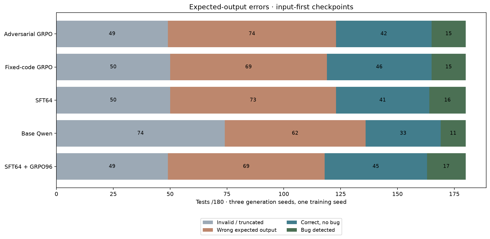

# Incorrect expected outputs

Error counts across three generation seeds for base Qwen, input-first SFT64 and the GRPO branches.

| Checkpoint | Correct expected /180 | Valid but incorrect expected /180 | Bug-exposing input with incorrect expected |
|---|---|---|---|
| grpo96 | 62 | 69 | 36 |
| Base Qwen | 44 | 62 | 29 |
| SFT64 | 57 | 73 | 35 |
| Fixed-code GRPO | 61 | 69 | 36 |
| Adversarial GRPO | 57 | 74 | 38 |

SFT64 + GRPO96 produced 69/180 valid samples with an incorrect expected output. Of those, 36 inputs could expose a bug. Per-problem counts are in per-problem.csv.

Figure 1. Incorrect expected outputs.

## Data files

[analysis.json](analysis.json) · [counts.csv](counts.csv) · [per-problem.csv](per-problem.csv) · [wrong-expected-examples.json](wrong-expected-examples.json)

[Evaluation guide](../../docs/EXPERIMENTS.md).
