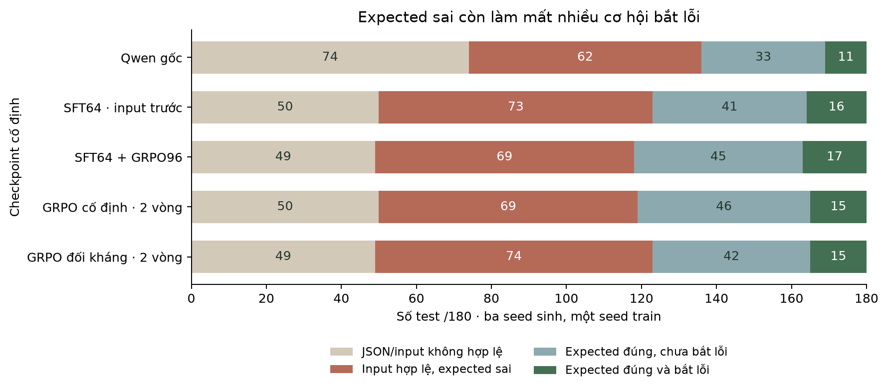

# Vì sao expected còn sai?

Đếm lại đầu ra Validation của 5 checkpoint, mỗi checkpoint 3 seed sinh × 60 test. Một seed train; không phải 3 lần huấn luyện. Không mở Test.

| Phiên bản | Hợp lệ nhưng expected sai /180 | Sai kiểu Python | Expected sai trùng output code lỗi | Input làm lộ lỗi nhưng expected sai | Expected đúng /180 |
|---|---:|---:|---:|---:|---:|
| grpo96 | 69 | 0 | 6 | 36 | 62 |
| base | 62 | 0 | 5 | 29 | 44 |
| sft | 73 | 0 | 5 | 35 | 57 |
| control | 69 | 0 | 6 | 36 | 61 |
| adaptive | 74 | 0 | 6 | 38 | 57 |

Các cột con có thể chồng lấn, không cộng thành tổng. Trùng output code lỗi chỉ là quan sát; không đủ để kết luận model đã sao chép phép tính của code. Input làm lộ lỗi là phép chẩn đoán bằng reference, chưa phải test hợp lệ nếu expected sai.

## Hướng xử lý

Ưu tiên học nhãn input-first đúng lâu hơn trong một phép thử có trần ngân sách. Giữ nguyên nhãn, seed, prompt, LoRA và cách chấm; kiểm tra Train trước, chỉ chấm Validation nếu qua điều kiện ghi trước. Không thay expected do model sinh bằng đáp án reference rồi tính là model làm đúng.

Độ đúng expected và khả năng chọn input bắt lỗi là hai năng lực khác nhau. Học thêm có thể giúp định dạng hoặc tính đáp án, nhưng cũng có thể chỉ nhớ Train. Bởi vậy phải so cả expected, số test bắt lỗi và số code phát hiện, không chỉ nhìn loss giảm.

## Một ví dụ kiểm tra bằng tay

APPS 2834 yêu cầu điểm đối xứng P qua tâm Q, công thức P′ = 2Q − P. Với P = [2, 0], Q = [0, 0], đáp án là [−2, 0]. Một đầu ra đã lưu của SFT64 lại ghi expected = [4, 0], còn code mutant trả [2, 0]. Input hợp lệ và thực sự phân biệt được reference với mutant, nhưng expected do model tính sai nên test không được tính bắt lỗi. Ở ví dụ này expected sai cũng không trùng output mutant.

Hình 1. Bốn nhóm loại trừ nhau, mẫu số 180 test mỗi checkpoint. Test bắt lỗi là phần con của expected đúng. Các lỗi định dạng và input vẫn được giữ trong mẫu số.

Các ví dụ cụ thể nằm trong wrong-expected-examples.json; dữ liệu gốc và hash từng lượt nằm trong analysis.json.
