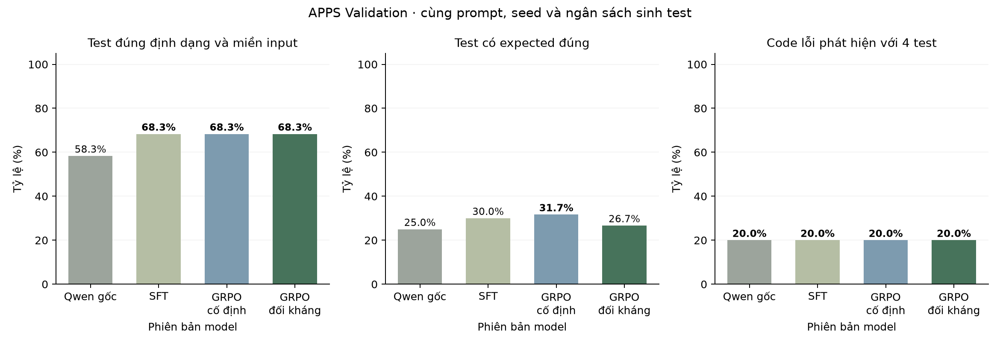

# APPS: GRPO cố định và curriculum đối kháng

Cùng checkpoint SFT, hai vòng × 48 bước/nhánh; optimizer được tạo lại ở đầu mỗi vòng ở cả hai nhánh. Validation: 15 code từ năm bài nguồn, bốn test/code, seed 42. Không đánh giá Test.

| Phiên bản | Hợp lệ /60 | Expected đúng /60 | Test bắt lỗi /60 | Code phát hiện @4 /15 |
|---|---:|---:|---:|---:|
| Qwen gốc | 35 | 15 | 4 | **3** |
| SFT | **41** | 18 | **6** | **3** |
| SFT + GRPO cố định | **41** | **19** | 4 | **3** |
| SFT + GRPO đối kháng | **41** | 16 | 5 | **3** |

Giá trị lớn nhất từng cột được in đậm, kể cả khi hòa. Đây là kết quả Validation của một seed, chưa chứng minh cải thiện ổn định.

| Vòng | Code được sinh | Code qua bộ lọc | Vị trí Train dùng code đối kháng /41 | Test RL sinh khi gặp code đối kháng |
|---|---:|---:|---:|---:|
| 1 | 208 | 17 | 8 | 40 |
| 2 | 192 | 16 | 16 | 80 |

Nhánh đối kháng phát hiện 3/15 code, đối chứng cố định phát hiện 3/15. Test bắt lỗi lần lượt 5/60 và 4/60.

Tổng cộng 30 hành vi code đối kháng khác nhau giữa các vòng; số code qua bộ lọc trong bảng có thể gồm hành vi lặp lại từ vòng trước.

Đối kháng ở đây có nghĩa là code vượt qua những test đúng mà policy hiện tại sinh được, đồng thời còn nhân chứng sai trong miền input đã khai báo. Điều đó không chứng minh code khó hơn với mọi model hoặc sai ở ít input hơn. Code không được hỗ trợ, code đúng toàn miền, code sai toàn miền, code trùng hành vi và code bị cắt đều bị loại.

Hai nhánh khớp số bước học và ngân sách sinh test; nhánh đối kháng tốn thêm chi phí probe và sinh/lọc code. Không tuyên bố tổng chi phí tính toán bằng nhau.

Các lượt GRPO cố định 96 bước một mạch trước đây vẫn được giữ trong results/apps-sft-grpo; không dùng chúng thay cho đối chứng hai vòng trong bảng này.

metrics.json giữ kế hoạch, hash, gradient/update, phân loại thất bại và thống kê từng vòng. per-problem.csv tách kết quả theo bài nguồn. Log đầy đủ và adapter lưu trên ổ D, không đưa vào Git.
