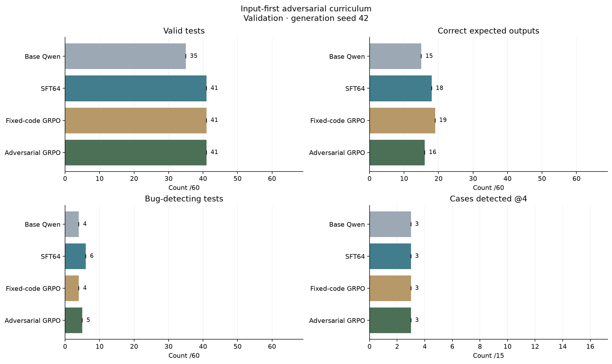

# Input-first adversarial curriculum

Both branches start from SFT64 with input-first targets and run two rounds of 48 GRPO steps. Results below use generation seed 42.

## Per-run counts

| Configuration | Valid /60 | Correct expected /60 | Bug-detecting tests /60 | Functions detected /15 |
|---|---|---|---|---|
| Base Qwen | 35 | 15 | 4 | 3 |
| SFT64 | 41 | 18 | 6 | 3 |
| Fixed-code GRPO | 41 | 19 | 4 | 3 |
| Adversarial GRPO | 41 | 16 | 5 | 3 |

Both branches detected 3/15 functions at seed 42.

Figure 1. Input-first adversarial curriculum.

## Data files

[metrics.csv](metrics.csv) · [metrics.json](metrics.json) · [per-problem.csv](per-problem.csv)

[Evaluation guide](../../docs/EXPERIMENTS.md).
