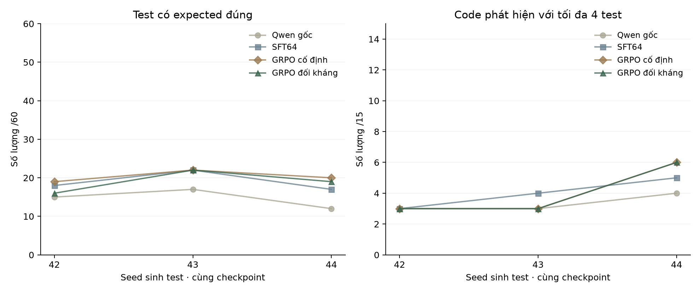

# Kiểm tra lấy mẫu của hai nhánh đối kháng và cố định

Cùng checkpoint SFT64, hai nhánh GRPO cuối sau 2 vòng × 48 bước, so với Qwen gốc. Ba seed sinh test 42/43/44, mỗi lượt 15 code Validation × 4 test. Dùng lại 8 lượt đã có, chạy mới 4 lượt; mọi kết quả tái sử dụng đều được kiểm tra hash. Kế hoạch và thời điểm được ghi rõ trong metrics.json.

**Đây là một seed huấn luyện và ba seed sinh test.** Không phải ba lần train độc lập. Không đổi checkpoint, prompt, tập dữ liệu hoặc trọng số; Test vẫn chưa dùng.

| Phiên bản | Seed sinh | Hợp lệ /60 | Expected đúng /60 | Test bắt lỗi /60 | Code phát hiện /15 |
|---|---:|---:|---:|---:|---:|
| Qwen gốc | 42 | 35 | 15 | 4 | 3 |
| SFT64 | 42 | 41 | 18 | 6 | 3 |
| GRPO cố định | 42 | 41 | 19 | 4 | 3 |
| GRPO đối kháng | 42 | 41 | 16 | 5 | 3 |
| Qwen gốc | 43 | 35 | 17 | 3 | 3 |
| SFT64 | 43 | 42 | 22 | 5 | 4 |
| GRPO cố định | 43 | 42 | 22 | 4 | 3 |
| GRPO đối kháng | 43 | 43 | 22 | 4 | 3 |
| Qwen gốc | 44 | 36 | 12 | 4 | 4 |
| SFT64 | 44 | 47 | 17 | 5 | 5 |
| GRPO cố định | 44 | 47 | 20 | 7 | 6 |
| GRPO đối kháng | 44 | 47 | 19 | 6 | 6 |

## Trung bình ± độ lệch chuẩn mẫu

| Phiên bản | Hợp lệ /60 | Expected đúng /60 | Test bắt lỗi /60 | Code phát hiện /15 |
|---|---:|---:|---:|---:|
| Qwen gốc | 35.33 ± 0.58 | 14.67 ± 2.52 | 3.67 ± 0.58 | 3.33 ± 0.58 |
| SFT64 | 43.33 ± 3.21 | 19.00 ± 2.65 | **5.33 ± 0.58** | **4.00 ± 1.00** |
| GRPO cố định | 43.33 ± 3.21 | **20.33 ± 1.53** | 5.00 ± 1.73 | **4.00 ± 1.73** |
| GRPO đối kháng | **43.67 ± 3.06** | 19.00 ± 3.00 | 5.00 ± 1.00 | **4.00 ± 1.73** |

Chữ đậm đánh dấu trung bình cao nhất, kể cả khi hòa. SD mô tả biến động lấy mẫu, không phải khoảng tin cậy; các mutant cùng bài có tương quan. Không dùng bảng này để tuyên bố ý nghĩa thống kê.

## Đối kháng trừ cố định theo cùng seed

| Seed sinh | Hợp lệ | Expected đúng | Test bắt lỗi | Code phát hiện |
|---:|---:|---:|---:|---:|
| 42 | +0 | -3 | +1 | +0 |
| 43 | +1 | +0 | +0 | +0 |
| 44 | +0 | -1 | -1 | +0 |

Hình 1. Kết quả của bốn checkpoint cố định. Mỗi điểm là một lần sinh 60 test; trục dọc ghi số lượng và mẫu số. Các đường trùng nhau vẫn được giữ nguyên.

## Chi phí thực hiện đã ghi được

| Nhánh | GRPO (giây) | Probe + sinh/lọc code (giây) | Chấm Validation hai vòng (giây) | Đỉnh PyTorch cấp phát (GiB) |
|---|---:|---:|---:|---:|
| GRPO cố định | 565.8 | 0.0 | 51.6 | 4.800 |
| GRPO đối kháng | 581.9 | 877.0 | 50.0 | 4.836 |

SFT64 dùng chung: 184.5 giây, không cộng hai lần vào chênh lệch hai nhánh. Nhánh đối kháng còn phải probe Train và sinh/lọc code; vì vậy cùng 96 bước GRPO không có nghĩa là cùng tổng chi phí.

Đây là tổng các pha có thời gian được ghi, chưa phải tổng thời gian từ bấm chạy đến hoàn tất. Nạp model, audit, tạo curriculum, điều phối và khoảng chờ chưa được bao quát đầy đủ. Đỉnh PyTorch cấp phát không phải tổng VRAM máy/GPU; không cộng các đỉnh giữa các pha. Không lấy thời gian export TensorBoard làm thời gian train.

Raw output, adapter và kế hoạch nằm trong thư mục evidence được ghi ở metrics.json. Chạy lại bảng/hình từ evidence: `python scripts/apps_adversarial_review.py --summarize <folder>`. Không cần nạp model để dựng lại.
