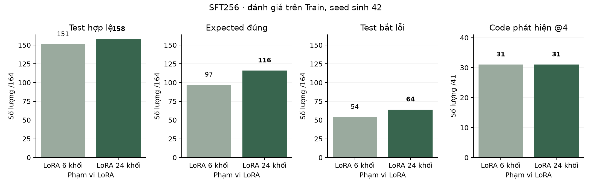
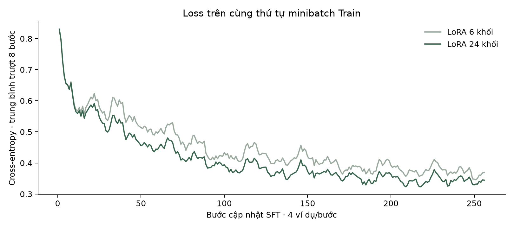
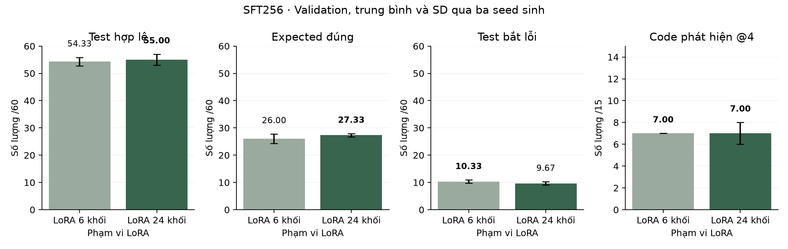

# Phạm vi LoRA với nhãn input-first

Giữ cùng 319 nhãn input-first, thứ tự học và 256 bước SFT. LoRA 6 khối có 208.896 tham số; LoRA 24 khối có 798.720 tham số.

## Train

| Cấu hình | Hợp lệ /164 | Expected đúng /164 | Test bắt lỗi /164 | Code phát hiện /41 |
|---|---|---|---|---|
| LoRA 6 khối | 151 | 97 | 54 | 31 |
| LoRA 24 khối | 158 | 116 | 64 | 31 |

## Validation

| Cấu hình | Hợp lệ /60 | Expected đúng /60 | Test bắt lỗi /60 | Code phát hiện /15 |
|---|---|---|---|---|
| LoRA 6 khối | 54,33 ± 1,53 | 26,00 ± 1,73 | **10,33 ± 0,58** | **7,00 ± 0,00** |
| LoRA 24 khối | **55,00 ± 2,00** | **27,33 ± 0,58** | 9,67 ± 0,58 | **7,00 ± 1,00** |

Trung bình ± SD trên ba seed sinh; mỗi cấu hình có một lượt train.

## Kết quả từng lượt

| Cấu hình | Seed sinh | Hợp lệ /60 | Expected đúng /60 | Test bắt lỗi /60 | Code phát hiện /15 |
|---|---|---|---|---|---|
| LoRA 6 khối | 42 | 53 | 27 | 10 | 7 |
| LoRA 6 khối | 43 | 56 | 27 | 10 | 7 |
| LoRA 6 khối | 44 | 54 | 24 | 11 | 7 |
| LoRA 24 khối | 42 | 53 | 27 | 10 | 8 |
| LoRA 24 khối | 43 | 55 | 28 | 9 | 6 |
| LoRA 24 khối | 44 | 57 | 27 | 10 | 7 |

## Theo bài Validation

| Bài APPS | Expected · 6 khối | Expected · 24 khối | Test bắt lỗi · 6 khối | Test bắt lỗi · 24 khối |
|---|---|---|---|---|
| 2834 | 4/36 | 4/36 | 0/36 | 0/36 |
| 2868 | 22/36 | 24/36 | 7/36 | 8/36 |
| 2947 | 14/36 | 16/36 | 4/36 | 3/36 |
| 2968 | 18/36 | 20/36 | 12/36 | 12/36 |
| 3014 | 20/36 | 18/36 | 8/36 | 6/36 |

Expected trung bình: 26,00 → 27,33/60; test bắt lỗi: 10,33 → 9,67/60; code phát hiện: 7,00 → 7,00/15. Điều kiện đặt trước là tăng ít nhất 9 expected đúng trên tổng 180 test, đồng thời các số đếm còn lại không giảm. Kết quả chưa đạt điều kiện này; giữ checkpoint 6 khối. Đối chứng 6 khối dùng lại lượt SFT256 đã lưu; ứng viên 24 khối được học mới. Đây là phép thử phạm vi LoRA, với một seed train cho mỗi cấu hình.

Hình 1. Hai adapter SFT256 trên Train: 164 test, 41 code lỗi, seed sinh 42.

Hình 2. Loss của hai adapter trên cùng thứ tự ví dụ Train; trung bình trượt 8 bước.

Hình 3. Validation: 60 test trên 15 code lỗi mỗi seed; cột là trung bình và thanh sai số là SD của ba seed sinh.

Qwen3.5-2B có kiến trúc xen kẽ linear attention và full attention; [cấu hình của model](https://huggingface.co/Qwen/Qwen3.5-2B) là cơ sở chọn các lớp mở rộng. Loss trên Train đo mức khớp dữ liệu học; kết luận chất lượng cần dựa vào đánh giá riêng.

## Dữ liệu

[costs.json](costs.json) · [metrics.csv](metrics.csv) · [metrics.json](metrics.json) · [per-problem.csv](per-problem.csv) · [train.csv](train.csv)

[Cấu hình và chỉ số đánh giá](../../docs/EXPERIMENTS.md).
