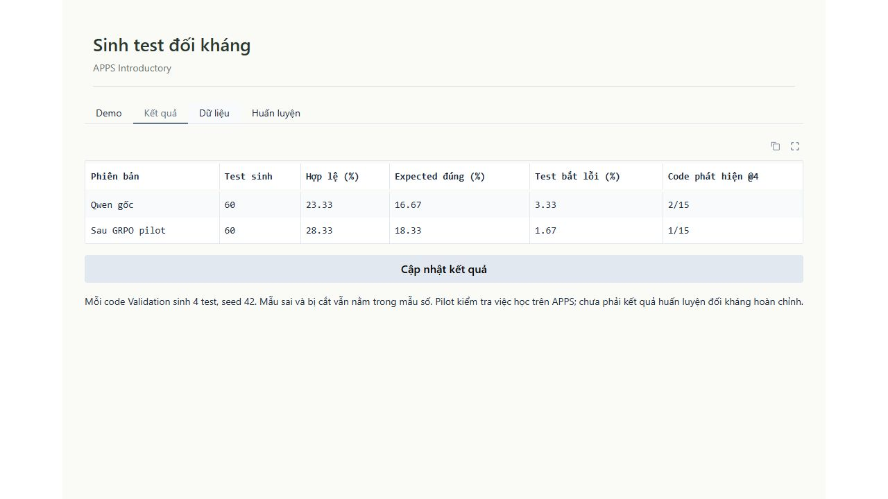
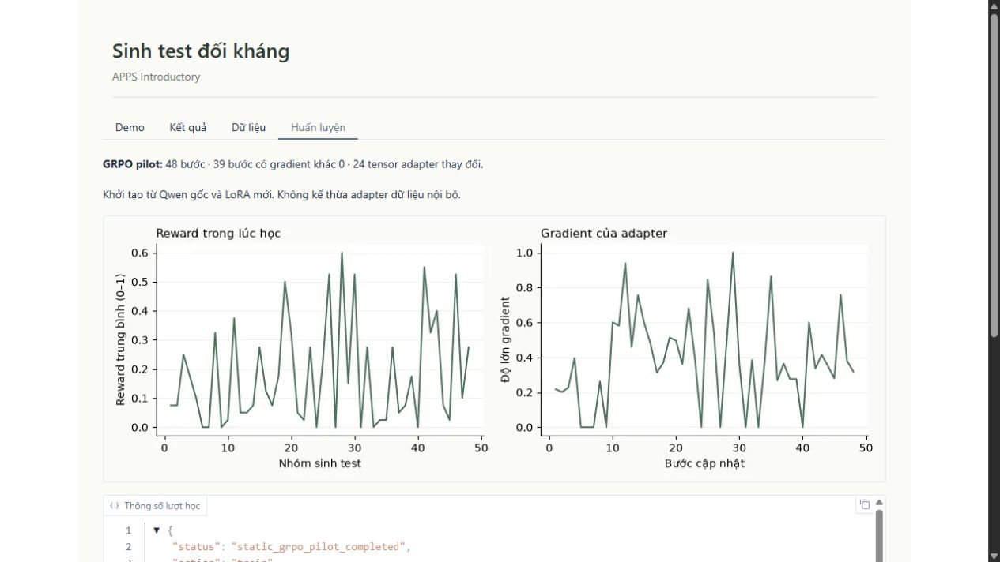

# Pilot APPS đầu tiên

Số liệu ở `metrics.json` và `metrics.csv` được xuất từ kết quả đã chạy, không từ ảnh chụp. Mỗi lượt Validation có 15 code lỗi thuộc 5 bài APPS, mỗi code sinh 4 test. Giữ nguyên mẫu số 60 kể cả test sai hoặc bị cắt.

Hai lượt dùng cùng hash prompt cho từng code, cùng dữ liệu, bộ chấm, cấu hình sinh và seed 42. Pilot khởi tạo LoRA mới từ Qwen gốc, học GRPO 48 bước trên Train. Chưa dùng SFT hoặc curriculum đối kháng trên APPS.

Tỷ lệ hợp lệ tăng 5 điểm phần trăm và expected đúng tăng khoảng 1,67 điểm phần trăm. Số code bắt được lỗi giảm từ 2/15 xuống 1/15. Vì vậy chưa kết luận model tìm lỗi tốt hơn.

Nhóm lỗi lớn nhất là sai cấu trúc input hoặc ngoài miền thực nghiệm: baseline 42/60, pilot 38/60. Ngoài ra còn sai JSON, bị cắt và expected sai. Phân loại đầy đủ nằm trong `metrics.json`; không sửa output rồi tính lại thành test đúng.

Các biểu đồ mô tả quá trình học, không thay thế đánh giá chất lượng. Log đầy đủ, bản chụp mã nguồn lúc chạy và adapter nằm tại các thư mục evidence ghi trong `metrics.json`, trên D:. Test phát triển và Test chính thức chưa được model đánh giá.
