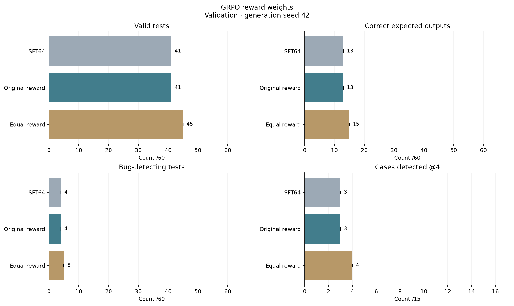

# GRPO reward weights

Both runs start from the same expected-first SFT64 adapter and use 96 GRPO steps. Component weights 0.1/0.2/0.7 are compared with equal weights of 1/3.

## Per-run counts

| Configuration | Valid /60 | Correct expected /60 | Bug-detecting tests /60 | Functions detected /15 |
|---|---|---|---|---|
| SFT64 | 41 | 13 | 4 | 3 |
| Weighted reward (0.1/0.2/0.7) | 41 | 13 | 4 | 3 |
| Equal reward | 45 | 15 | 5 | 4 |

Equal weights improved the seed-42 result slightly, but the gain was not consistent when resampled with seeds 43/44.

Figure 1. GRPO reward weights.

[Resampling across three seeds](SAMPLING.md).

## Data files

[error-examples.json](error-examples.json) · [metrics.csv](metrics.csv) · [metrics.json](metrics.json) · [per-case.csv](per-case.csv) · [sampling-metrics.csv](sampling-metrics.csv) · [sampling-metrics.json](sampling-metrics.json)

[Evaluation guide](../../docs/EXPERIMENTS.md).
