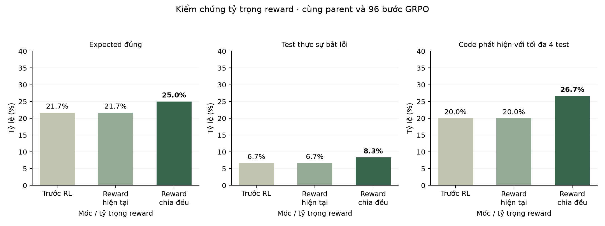
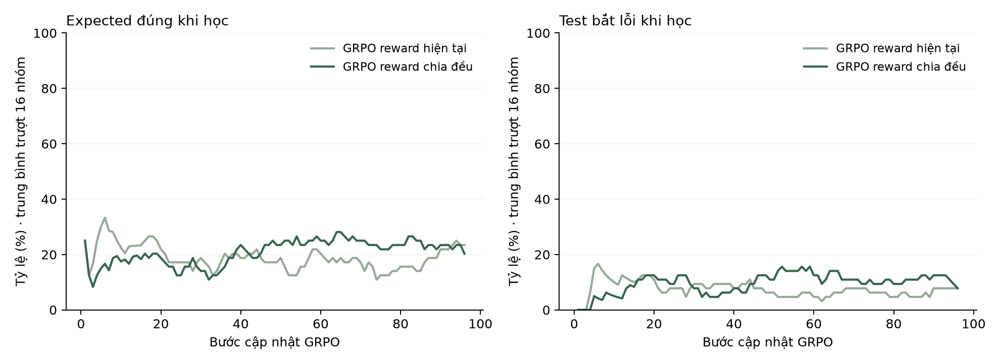

# APPS: kiểm chứng tỷ trọng phần thưởng GRPO

Hai lượt mới cùng xuất phát từ SFT64 lịch sử, cùng 41 code Train, seed 42, prompt v2, LoRA rank 4, optimizer mới và 96 bước/nhánh. Thứ tự code và ngân sách rollout được kiểm tra khớp. Khác biệt chủ đích duy nhất là tỷ trọng reward; không thay curriculum đối kháng trong phép thử này.

| Thành phần | Hiện tại · legacy-v1 | Chia đều · equal-v1 |
|---|---:|---:|
| Định dạng JSON và input đúng miền | 0,1 | 1/3 |
| Expected đúng | 0,2 | 1/3 |
| Expected đúng và bắt lỗi | 0,7 | 1/3 |

Reward là tổng các thành phần thỏa mãn. Vì vậy bốn mức ở nhánh hiện tại là 0 / 0,1 / 0,3 / 1; nhánh chia đều là 0 / 1/3 / 2/3 / 1. Attack luôn bị chặn khi expected sai. Đầu ra bị cắt và test không hợp lệ nhận 0.

[ATGen §4.1 và §5.1](https://arxiv.org/html/2510.14635v1) dùng tổng ba thành phần với trọng số bằng nhau. Phép thử này tham khảo tỷ trọng đó và chuẩn hóa tổng tối đa về 1; tiêu chí định dạng vẫn là JSON/miền input của đồ án, khác thẻ thinking của bài báo. Đây không phải tái lập đầy đủ reward và benchmark gốc.

## Validation

| Mốc | Hợp lệ /60 | Expected đúng /60 | Test bắt lỗi /60 | Code phát hiện @4 /15 |
|---|---:|---:|---:|---:|
| SFT64 trước RL | 41 | 13 | 4 | 3 |
| GRPO reward hiện tại | 41 | 13 | 4 | 3 |
| GRPO reward chia đều | **45** | **15** | **5** | **4** |

Chữ đậm là giá trị lớn nhất từng cột, kể cả khi hòa. Mỗi code sinh bốn test, cùng giới hạn 96 token và seed theo case. Mẫu sai/bị cắt vẫn ở mẫu số; expected không được sửa bằng oracle. Chỉ đánh giá checkpoint cuối sau khi cả hai nhánh đã học xong.

## Kiểm chứng việc học

| Nhánh | Bước GRPO | Gradient khác 0 | Nhóm có tín hiệu | Tensor LoRA đổi | Đỉnh VRAM PyTorch (GiB) |
|---|---:|---:|---:|---:|---:|
| GRPO reward hiện tại | 96 | 88 | 88 | 24 | 4.836 |
| GRPO reward chia đều | 96 | 83 | 83 | 24 | 4.836 |

Trọng số nền được đóng băng; chỉ LoRA có gradient. Cả hai adapter đã lưu đều khớp tensor sau học. Chấm lại toàn bộ rollout theo đúng profile, đồng thời kiểm tra các cờ chấm chính bằng bộ chấm giữ nguyên. Có cập nhật tham số chưa tự chứng minh hiệu quả tìm lỗi.

## Đọc kết quả

Ứng viên chia đều qua tiêu chí đặt trước để cân nhắc so sánh đối kháng tiếp theo: **False**. Tiêu chí yêu cầu expected đúng tăng ít nhất 3/60 so với đối chứng mới và không giảm hợp lệ, test bắt lỗi hay code phát hiện so với đối chứng hoặc parent. Không tự thay checkpoint đang dùng.

Hai nhánh có 49/60 đầu ra trùng nguyên văn. Code chỉ nhánh chia đều phát hiện: apps-train-3014/m3. Code chỉ nhánh hiện tại phát hiện: không có.

Kết quả trên Train chỉ đo mức khớp tập học, tách riêng trong metrics.json. Reward trung bình của hai profile dùng thang thành phần khác nhau nên không được dùng để kết luận nhánh nào tốt hơn; hình quá trình học bên dưới dùng cùng cờ expected/attack đã kiểm chứng.

Một seed train, một seed sinh test và năm bài Validation; các code trong cùng bài có tương quan. Chưa đủ kết luận ổn định hay ý nghĩa thống kê. CUDA nondeterminism chưa loại trừ. Đây là ablation trên dữ liệu cố định, không đo lợi ích của adaptive curriculum. Cả Test phát triển và Test chính thức tiếp tục được giữ lại.

## Tín hiệu nhóm và giới hạn khi đổi reward

GRPO hiện chuẩn hóa reward trong từng nhóm bốn mẫu. Nếu một nhóm chỉ có hai mức kết quả, đổi khoảng cách dương giữa hai mức gần như không đổi điểm chuẩn hóa tương đối; epsilon và tính toán số có thể tạo sai khác nhỏ. Nhóm từ ba mức trở lên mới làm tỷ trọng giữa các mục tiêu thể hiện rõ hơn. Đây là nhận xét về cơ chế, không tự chứng minh nguyên nhân chất lượng model.

metrics.json lưu chẩn đoán đổi profile trên chính các mẫu đã lưu của mỗi nhánh. Chẩn đoán dùng số thực float64, độ lệch chuẩn mẫu và epsilon 1e-4; không gọi đó là advantage được lấy trực tiếp từ trainer hoặc kết quả của một lượt train khác. error-examples.json giữ mẫu đầu tiên theo mỗi loại thành công, sai expected và không hợp lệ để chuẩn bị giải thích; tần suất phải lấy từ toàn bộ kết quả.

## Chạy lại và bằng chứng

Kế hoạch có timestamp, nguồn đóng băng, hash parent, raw rollout, gradient và adapter nằm trong trial_folder ở metrics.json. Chạy scripts/apps_reward_trial.py để tạo một trial mới; script không công bố đè lên các mốc chính. Sau khi hoàn tất, dùng scripts/summarize_apps_rewards.py với đường dẫn trial để dựng lại bảng/hình.

[Kiểm tra ba seed sinh test](SAMPLING.md). Kế hoạch bổ sung được ghi trước Validation mới; mọi seed đều được giữ, không thay tiêu chí ban đầu.
