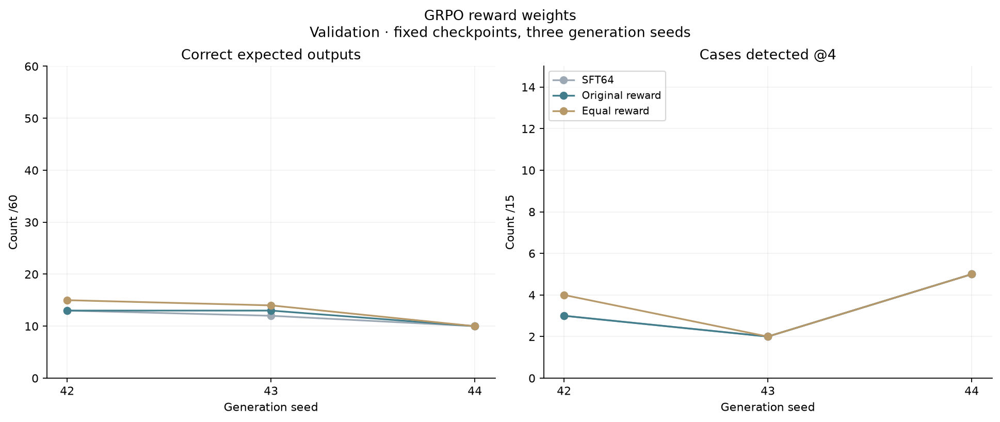

# Reward comparison by generation seed

Fixed checkpoints evaluated with generation seeds 42/43/44. Each run generates 60 tests for 15 Validation functions.

| Configuration | Generation seed | Valid /60 | Correct expected /60 | Bug-detecting tests /60 | Functions detected /15 |
|---|---|---|---|---|---|
| SFT64 | 42 | 41 | 13 | 4 | 3 |
| Weighted reward (0.1/0.2/0.7) | 42 | 41 | 13 | 4 | 3 |
| Equal reward | 42 | 45 | 15 | 5 | 4 |
| SFT64 | 43 | 42 | 12 | 2 | 2 |
| Weighted reward (0.1/0.2/0.7) | 43 | 40 | 13 | 2 | 2 |
| Equal reward | 43 | 42 | 14 | 2 | 2 |
| SFT64 | 44 | 46 | 10 | 5 | 5 |
| Weighted reward (0.1/0.2/0.7) | 44 | 45 | 10 | 5 | 5 |
| Equal reward | 44 | 46 | 10 | 5 | 5 |

One training seed and three generation seeds. Per-seed counts show sampling variability.

Figure 1. Resampled checkpoint results.

[Data files](sampling-metrics.json) · [Reward experiment](README.md).
