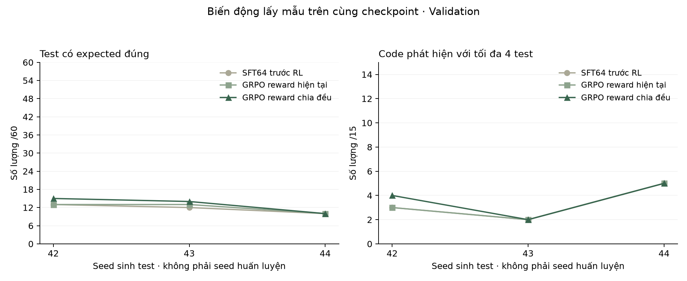

# Reward: kết quả theo seed sinh

Các checkpoint cố định được đánh giá với seed sinh 42/43/44, mỗi lượt 60 test trên 15 code Validation.

| Cấu hình | Seed sinh | Hợp lệ /60 | Expected đúng /60 | Test bắt lỗi /60 | Code phát hiện /15 |
|---|---|---|---|---|---|
| SFT64 | 42 | 41 | 13 | 4 | 3 |
| Reward 0,1/0,2/0,7 | 42 | 41 | 13 | 4 | 3 |
| Reward chia đều | 42 | 45 | 15 | 5 | 4 |
| SFT64 | 43 | 42 | 12 | 2 | 2 |
| Reward 0,1/0,2/0,7 | 43 | 40 | 13 | 2 | 2 |
| Reward chia đều | 43 | 42 | 14 | 2 | 2 |
| SFT64 | 44 | 46 | 10 | 5 | 5 |
| Reward 0,1/0,2/0,7 | 44 | 45 | 10 | 5 | 5 |
| Reward chia đều | 44 | 46 | 10 | 5 | 5 |

Một seed train, ba seed sinh. Các số đếm theo seed được giữ để xem biến động lấy mẫu.

Hình 1. Kết quả sinh lại của các checkpoint.

[Dữ liệu](sampling-metrics.json) · [Thí nghiệm reward](README.md).
