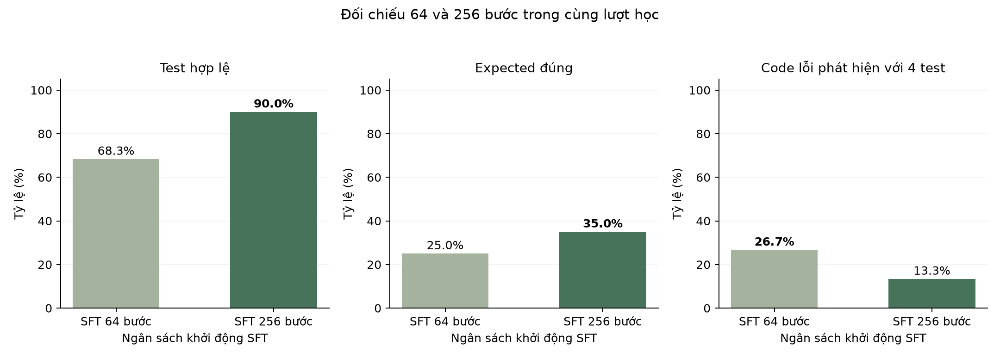
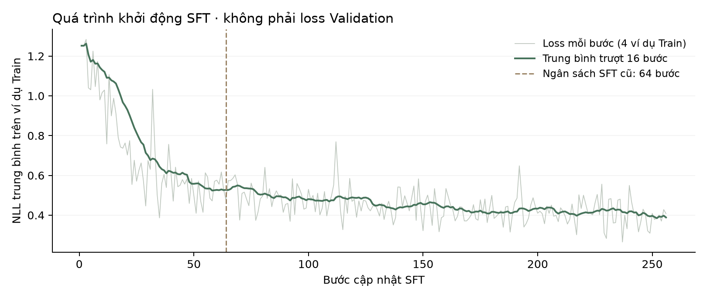

# Ngân sách SFT với nhãn expected-first

So sánh 64 và 256 bước SFT với cùng pool nhãn và prompt. Có checkpoint 64 của chính lượt học mới để đối chiếu.

## Kết quả từng lượt

| Cấu hình | Hợp lệ /60 | Expected đúng /60 | Test bắt lỗi /60 | Code phát hiện /15 |
|---|---|---|---|---|
| SFT64 trước đó | 41 | 13 | 4 | 3 |
| SFT64 cùng lượt | 41 | 15 | 5 | 4 |
| SFT256 | 54 | 21 | 3 | 2 |

SFT256 tăng expected nhưng giảm số code phát hiện. Kết quả này thuộc cấu hình nhãn cũ.

Hình 1. Ngân sách SFT với nhãn expected-first.

Hình 2. Ngân sách SFT với nhãn expected-first.

## Dữ liệu

[metrics.csv](metrics.csv) · [metrics.json](metrics.json) · [per-case.csv](per-case.csv)

[Cấu hình và chỉ số đánh giá](../../docs/EXPERIMENTS.md).
