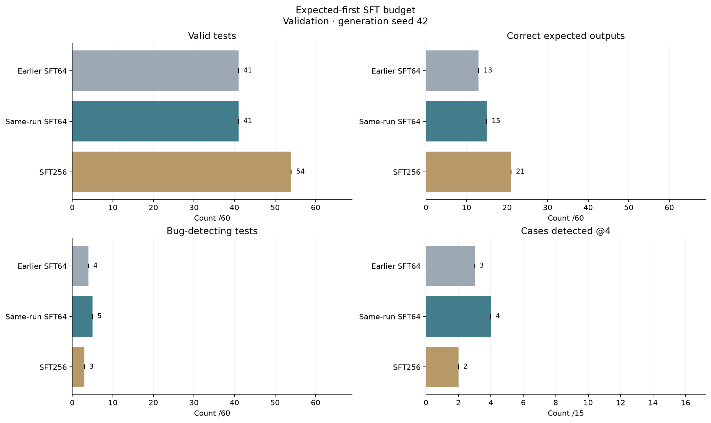

# Expected-first SFT budget

Comparison of 64 and 256 SFT steps with the same label pool and prompt. The new training run retains its own 64-step checkpoint for comparison.

## Per-run counts

| Configuration | Valid /60 | Correct expected /60 | Bug-detecting tests /60 | Functions detected /15 |
|---|---|---|---|---|
| Earlier SFT64 | 41 | 13 | 4 | 3 |
| Same-run SFT64 | 41 | 15 | 5 | 4 |
| SFT256 | 54 | 21 | 3 | 2 |

SFT256 increased correct expected outputs but detected fewer functions. This trial uses the earlier expected-first labels.

Figure 1. Expected-first SFT budget.

## Data files

[metrics.csv](metrics.csv) · [metrics.json](metrics.json) · [per-case.csv](per-case.csv)

[Evaluation guide](../../docs/EXPERIMENTS.md).
