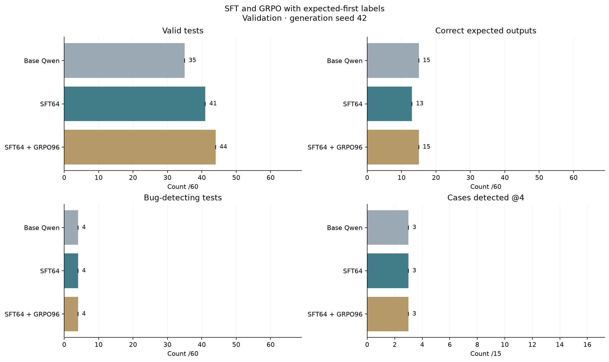

# SFT and GRPO with expected-first labels

Base Qwen, SFT64 and GRPO96 evaluated on 15 Validation functions with generation seed 42. SFT targets place expected before input.

## Per-run counts

| Configuration | Valid /60 | Correct expected /60 | Bug-detecting tests /60 | Functions detected /15 |
|---|---|---|---|---|
| Base Qwen | 35 | 15 | 4 | 3 |
| SFT64 | 41 | 13 | 4 | 3 |
| SFT64 + GRPO96 | 44 | 15 | 4 | 3 |

Training increased valid outputs, while detected functions remained at 3/15.

Figure 1. SFT and GRPO with expected-first labels.

## Data files

[metrics.csv](metrics.csv) · [metrics.json](metrics.json) · [per-problem.csv](per-problem.csv)

[Evaluation guide](../../docs/EXPERIMENTS.md).
