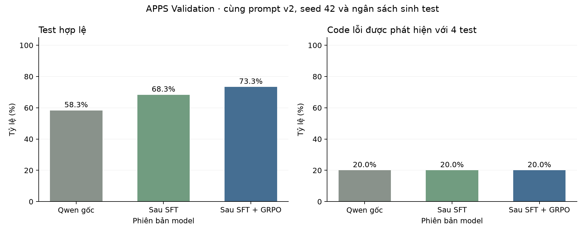

# SFT và GRPO với nhãn expected-first

So sánh Qwen gốc, SFT64 và GRPO96 trên 15 code Validation, seed 42. Nhãn SFT ở lượt này đặt expected trước input.

## Kết quả từng lượt

| Cấu hình | Hợp lệ /60 | Expected đúng /60 | Test bắt lỗi /60 | Code phát hiện /15 |
|---|---|---|---|---|
| Qwen gốc | 35 | 15 | 4 | 3 |
| SFT64 | 41 | 13 | 4 | 3 |
| SFT64 + GRPO96 | 44 | 15 | 4 | 3 |

Tỷ lệ hợp lệ tăng sau học; số code phát hiện vẫn là 3/15.

Hình 1. SFT và GRPO với nhãn expected-first.

## Dữ liệu

[metrics.csv](metrics.csv) · [metrics.json](metrics.json) · [per-problem.csv](per-problem.csv)

[Cấu hình và chỉ số đánh giá](../../docs/EXPERIMENTS.md).
