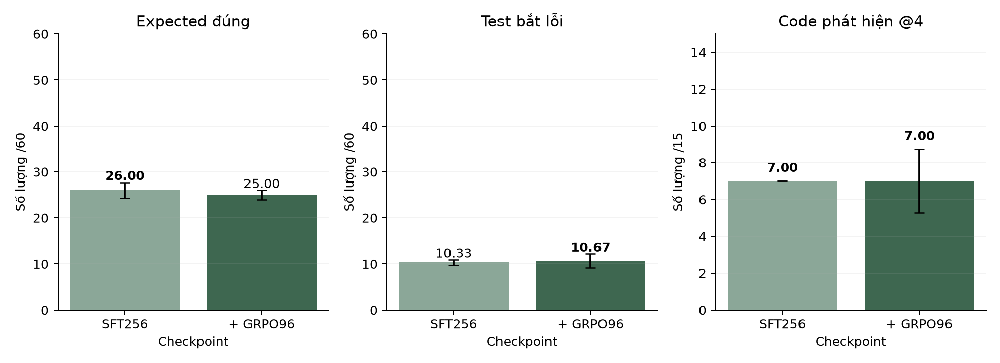

# GRPO với reward chia đều sau SFT256

Từ cùng adapter SFT256, học 96 bước GRPO với trọng số định dạng, expected và attack cùng bằng 1/3. Các điều kiện khác giữ như lượt reward mặc định.

| Cấu hình | Hợp lệ /60 | Expected đúng /60 | Test bắt lỗi /60 | Code phát hiện /15 |
|---|---|---|---|---|
| SFT256 | 54,33 ± 1,53 | **26,00 ± 1,73** | 10,33 ± 0,58 | **7,00 ± 0,00** |
| SFT256 + GRPO96 | **55,33 ± 2,08** | 25,00 ± 1,00 | **10,67 ± 1,53** | **7,00 ± 1,73** |

Trung bình ± SD trên ba seed sinh; mỗi cấu hình có một lượt train.

## Kết quả từng lượt

| Cấu hình | Seed sinh | Hợp lệ /60 | Expected đúng /60 | Test bắt lỗi /60 | Code phát hiện /15 |
|---|---|---|---|---|---|
| SFT256 | 42 | 53 | 27 | 10 | 7 |
| SFT256 | 43 | 56 | 27 | 10 | 7 |
| SFT256 | 44 | 54 | 24 | 11 | 7 |
| SFT256 + GRPO96 | 42 | 53 | 25 | 11 | 8 |
| SFT256 + GRPO96 | 43 | 57 | 24 | 9 | 5 |
| SFT256 + GRPO96 | 44 | 56 | 26 | 12 | 8 |

Quy tắc xếp hạng ưu tiên số code rồi số test bắt lỗi xếp nhánh RL trước nhờ thêm 1 test bắt lỗi trên tổng 180 test. Số code phát hiện trung bình bằng SFT, còn expected giảm; mức chênh lệch này chưa cho thấy chất lượng khái quát tốt hơn.

Seed 43 bị dừng khi khởi chạy Python, trước khi sinh test. Đã giữ lượt seed 42 và chạy nốt các seed còn thiếu với cùng adapter, prompt và ngân sách; không huấn luyện lại. Bản ghi nối lại nằm trong evaluation-recovery.json.

Hình 1. GRPO với reward chia đều sau SFT256.

## Dữ liệu

[costs.json](costs.json) · [errors.csv](errors.csv) · [evaluation-recovery.json](evaluation-recovery.json) · [metrics.csv](metrics.csv) · [metrics.json](metrics.json) · [reward-control.json](reward-control.json)

[Cấu hình và chỉ số đánh giá](../../docs/EXPERIMENTS.md).
