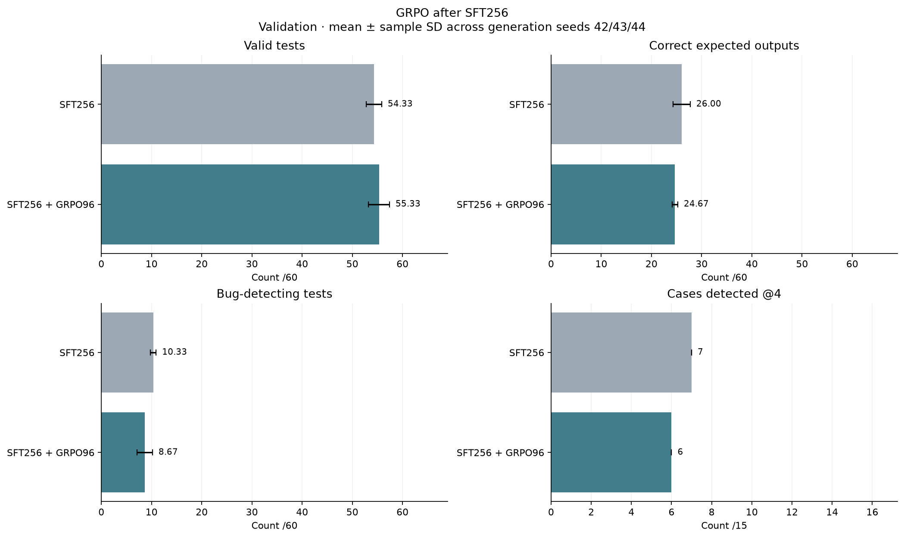

# GRPO after SFT256

A 96-step GRPO stage starts from the SFT256 adapter and uses fixed Train code. Parent and child are evaluated with the same three generation seeds.

| Configuration | Valid /60 | Correct expected /60 | Bug-detecting tests /60 | Functions detected /15 |
|---|---|---|---|---|
| SFT256 | 54.33 ± 1.53 | 26.00 ± 1.73 | 10.33 ± 0.58 | 7.00 ± 0.00 |
| SFT256 + GRPO96 | 55.33 ± 2.08 | 24.67 ± 0.58 | 8.67 ± 1.53 | 6.00 ± 0.00 |

Mean ± sample SD across three generation seeds; one training run per configuration.

## Per-run counts

| Configuration | Generation seed | Valid /60 | Correct expected /60 | Bug-detecting tests /60 | Functions detected /15 |
|---|---|---|---|---|---|
| SFT256 | 42 | 53 | 27 | 10 | 7 |
| SFT256 | 43 | 56 | 27 | 10 | 7 |
| SFT256 | 44 | 54 | 24 | 11 | 7 |
| SFT256 + GRPO96 | 42 | 53 | 24 | 9 | 6 |
| SFT256 + GRPO96 | 43 | 56 | 25 | 7 | 6 |
| SFT256 + GRPO96 | 44 | 57 | 25 | 10 | 6 |

SFT256 was selected within this pair using the recorded checkpoint-selection criterion. The table retains counts before and after GRPO.

Figure 1. GRPO after SFT256.

## Data files

[errors.csv](errors.csv) · [metrics.csv](metrics.csv) · [metrics.json](metrics.json)

[Evaluation guide](../../docs/EXPERIMENTS.md).
