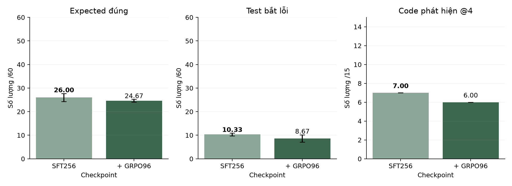

# Tác động thêm của GRPO từ SFT256

Cùng adapter SFT256 input-first, thêm96 bước GRPO trên code Train cố định. Chỉ thay phần học RL; giữ prompt, model nền, bộ chấm và ngân sách sinh. Không phải phép thử đối kháng mới. Đối chứng hai vòng đối kháng trước vẫn dùng warmup SFT64 riêng.

| Phiên bản | Seed sinh | Hợp lệ /60 | Expected đúng /60 | Test bắt lỗi /60 | Code phát hiện /15 |
|---|---:|---:|---:|---:|---:|
| sft256 | 42 | 53 | 27 | 10 | 7 |
| sft256 | 43 | 56 | 27 | 10 | 7 |
| sft256 | 44 | 54 | 24 | 11 | 7 |
| sft256-grpo96 | 42 | 53 | 24 | 9 | 6 |
| sft256-grpo96 | 43 | 56 | 25 | 7 | 6 |
| sft256-grpo96 | 44 | 57 | 25 | 10 | 6 |

| Phiên bản | Hợp lệ /60 | Expected đúng /60 | Test bắt lỗi /60 | Code phát hiện /15 |
|---|---:|---:|---:|---:|
| sft256 | 54.33 ± 1.53 | **26.00 ± 1.73** | **10.33 ± 0.58** | **7.00 ± 0.00** |
| sft256-grpo96 | **55.33 ± 2.08** | 24.67 ± 0.58 | 8.67 ± 1.53 | 6.00 ± 0.00 |

Chênh lệch GRPO − SFT trung bình: valid_tests: +1.00; correct_expected: -1.33; bug_detecting_tests: -1.67; cases_detected: -1.00.

Lựa chọn trong cặp này theo thứ tự code phát hiện, test bắt lỗi, expected, hợp lệ, rồi phương án đơn giản khi hòa: **sft256**. Chỉ là lựa chọn trên Validation, chưa phải thành tích Test.

Đã xác nhận đúng parent, gradient, tham số LoRA thay đổi, bản lưu và chấm lại toàn bộ raw output. Các bằng chứng cập nhật không tự chứng minh chất lượng tăng; bảng trên mới là so sánh chất lượng.

Một seed train, ba seed sinh. SD không phải khoảng tin cậy. Nhiều lượt điều chỉnh trên cùng năm bài Validation có nguy cơ chọn quá khớp; không chỉnh phương pháp theo Test. Phần tăng từ SFT64 lên SFT256 thuộc SFT, không cộng vào lợi ích RL.

Hình 1. Số đếm trung bình và SD lấy mẫu. Mẫu sai/bị cắt vẫn nằm trong mẫu số, trục ghi rõ đơn vị.
