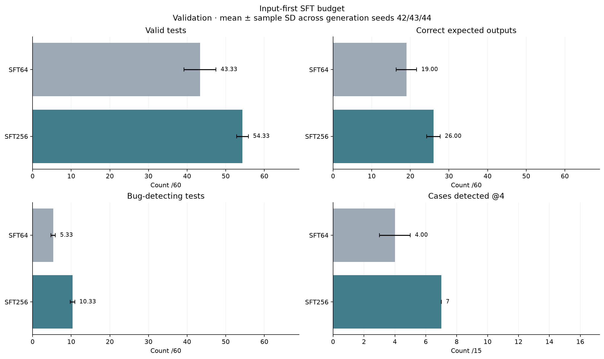

# Input-first SFT budget

The 64-step and 256-step checkpoints come from one training trajectory, sharing initialization and the first 64 steps. Validation uses three generation seeds.

| Configuration | Valid /60 | Correct expected /60 | Bug-detecting tests /60 | Functions detected /15 |
|---|---|---|---|---|
| 64 | 43.33 ± 4.16 | 19.00 ± 2.65 | 5.33 ± 0.58 | 4.00 ± 1.00 |
| 256 | 54.33 ± 1.53 | 26.00 ± 1.73 | 10.33 ± 0.58 | 7.00 ± 0.00 |

Mean ± sample SD across three generation seeds; one training run per configuration.

## Per-run counts

| SFT steps | Generation seed | Valid /60 | Correct expected /60 | Bug-detecting tests /60 | Functions detected /15 |
|---|---|---|---|---|---|
| 64 | 42 | 40 | 17 | 6 | 3 |
| 256 | 42 | 53 | 27 | 10 | 7 |
| 64 | 43 | 42 | 22 | 5 | 4 |
| 256 | 43 | 56 | 27 | 10 | 7 |
| 64 | 44 | 48 | 18 | 5 | 5 |
| 256 | 44 | 54 | 24 | 11 | 7 |

Mean correct expected outputs were 19.00/60 at SFT64 and 26.00/60 at SFT256; mean detected functions were 4.00/15 and 7.00/15, respectively.

Figure 1. Input-first SFT budget.

## Data files

[metrics.csv](metrics.csv) · [metrics.json](metrics.json)

[Evaluation guide](../../docs/EXPERIMENTS.md).
