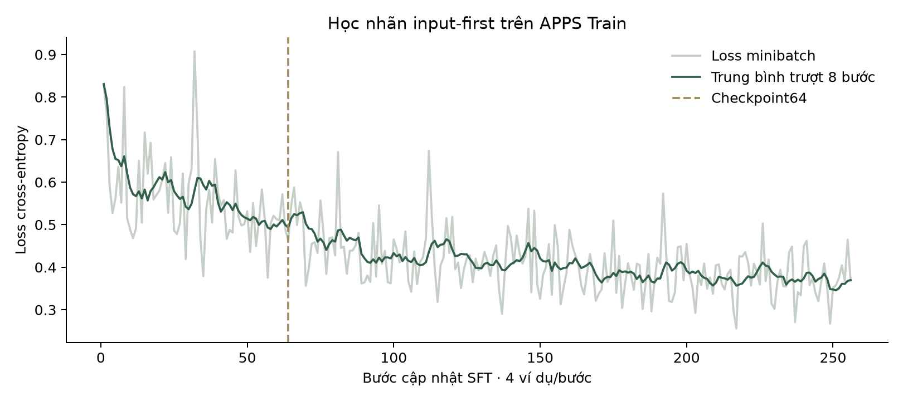

# Ngân sách SFT với nhãn input-first

Checkpoint 64 và 256 được lấy từ cùng một lượt học, chung model khởi đầu và 64 bước đầu. Bảng Validation dùng ba seed sinh.

| Cấu hình | Hợp lệ /60 | Expected đúng /60 | Test bắt lỗi /60 | Code phát hiện /15 |
|---|---|---|---|---|
| 64 | 43,33 ± 4,16 | 19,00 ± 2,65 | 5,33 ± 0,58 | 4,00 ± 1,00 |
| 256 | **54,33 ± 1,53** | **26,00 ± 1,73** | **10,33 ± 0,58** | **7,00 ± 0,00** |

Trung bình ± SD trên ba seed sinh; mỗi cấu hình có một lượt train.

## Kết quả từng lượt

| Bước SFT | Seed sinh | Hợp lệ /60 | Expected đúng /60 | Test bắt lỗi /60 | Code phát hiện /15 |
|---|---|---|---|---|---|
| 64 | 42 | 40 | 17 | 6 | 3 |
| 256 | 42 | 53 | 27 | 10 | 7 |
| 64 | 43 | 42 | 22 | 5 | 4 |
| 256 | 43 | 56 | 27 | 10 | 7 |
| 64 | 44 | 48 | 18 | 5 | 5 |
| 256 | 44 | 54 | 24 | 11 | 7 |

Expected trung bình ở SFT64 và SFT256 lần lượt là 19.00 và 26.00/60; số code phát hiện là 4.00 và 7.00/15.

Hình 1. Ngân sách SFT với nhãn input-first.

## Dữ liệu

[metrics.csv](metrics.csv) · [metrics.json](metrics.json)

[Cấu hình và chỉ số đánh giá](../../docs/EXPERIMENTS.md).
