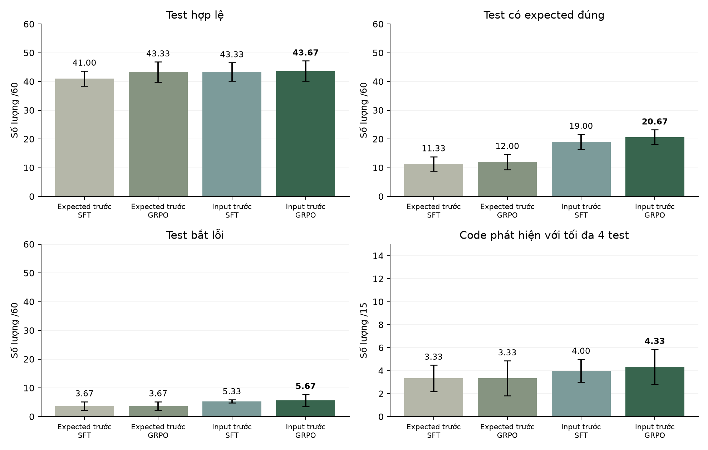

# Thứ tự trường trong nhãn SFT

Giữ nguyên 319 cặp input/expected và cấu hình học; đổi thứ tự hai trường ngoài cùng của target. So riêng các mốc SFT và GRPO.

| Cấu hình | Hợp lệ /60 | Expected đúng /60 | Test bắt lỗi /60 | Code phát hiện /15 |
|---|---|---|---|---|
| sorted-v1 / sft | 41,00 ± 2,65 | 11,33 ± 2,52 | 3,67 ± 1,53 | 3,33 ± 1,15 |
| sorted-v1 / grpo | 43,33 ± 3,51 | 12,00 ± 2,65 | 3,67 ± 1,53 | 3,33 ± 1,53 |
| input-first-v1 / sft | 43,33 ± 3,21 | 19,00 ± 2,65 | 5,33 ± 0,58 | 4,00 ± 1,00 |
| input-first-v1 / grpo | **43,67 ± 3,51** | **20,67 ± 2,52** | **5,67 ± 2,08** | **4,33 ± 1,53** |

Trung bình ± SD trên ba seed sinh; mỗi cấu hình có một lượt train.

## Kết quả từng lượt

| Nhãn | Mốc | Seed sinh | Hợp lệ /60 | Expected đúng /60 | Test bắt lỗi /60 | Code phát hiện /15 |
|---|---|---|---|---|---|---|
| sorted-v1 | SFT64 | 42 | 39 | 14 | 5 | 4 |
| sorted-v1 | GRPO | 42 | 43 | 14 | 4 | 3 |
| sorted-v1 | SFT64 | 43 | 40 | 11 | 2 | 2 |
| sorted-v1 | GRPO | 43 | 40 | 13 | 2 | 2 |
| sorted-v1 | SFT64 | 44 | 44 | 9 | 4 | 4 |
| sorted-v1 | GRPO | 44 | 47 | 9 | 5 | 5 |
| input-first-v1 | SFT64 | 42 | 41 | 18 | 6 | 3 |
| input-first-v1 | GRPO | 42 | 40 | 18 | 4 | 3 |
| input-first-v1 | SFT64 | 43 | 42 | 22 | 5 | 4 |
| input-first-v1 | GRPO | 43 | 44 | 23 | 5 | 4 |
| input-first-v1 | SFT64 | 44 | 47 | 17 | 5 | 5 |
| input-first-v1 | GRPO | 44 | 47 | 21 | 8 | 6 |

Input-first tăng expected ở cả ba seed sinh. Phần lớn thay đổi xuất hiện ngay sau SFT; mức tăng test bắt lỗi tập trung ở bài làm tròn 2947.

Hình 1. Thứ tự trường trong nhãn SFT.

## Dữ liệu

[costs.csv](costs.csv) · [errors.csv](errors.csv) · [metrics.csv](metrics.csv) · [metrics.json](metrics.json) · [paired-deltas.csv](paired-deltas.csv) · [per-case.csv](per-case.csv) · [per-problem.csv](per-problem.csv)

[Cấu hình và chỉ số đánh giá](../../docs/EXPERIMENTS.md).
